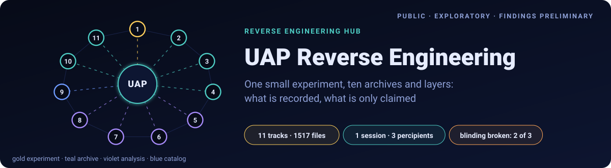
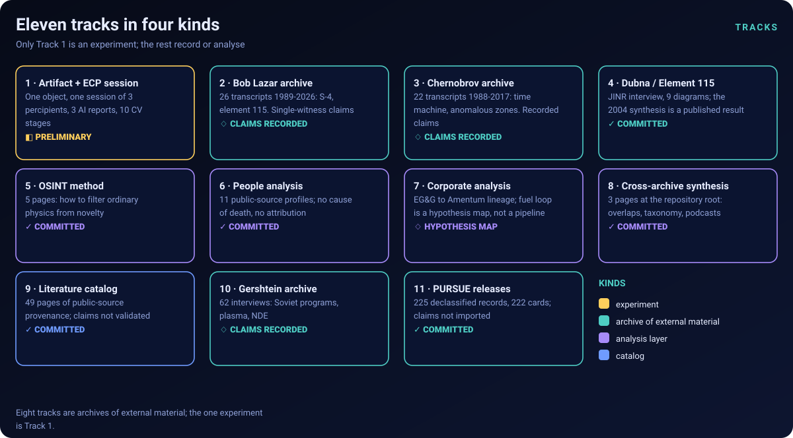
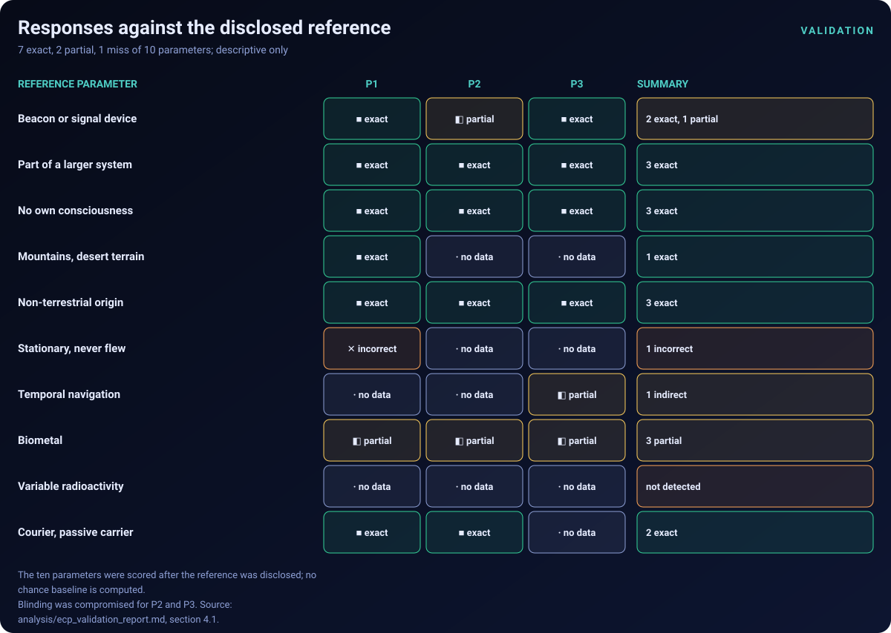
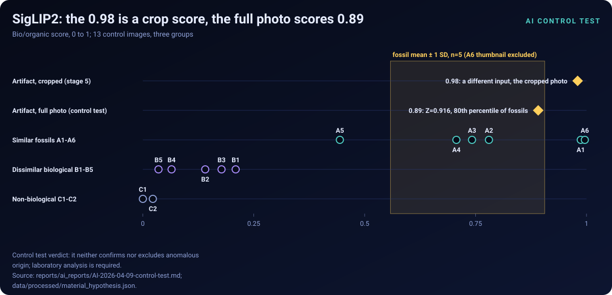
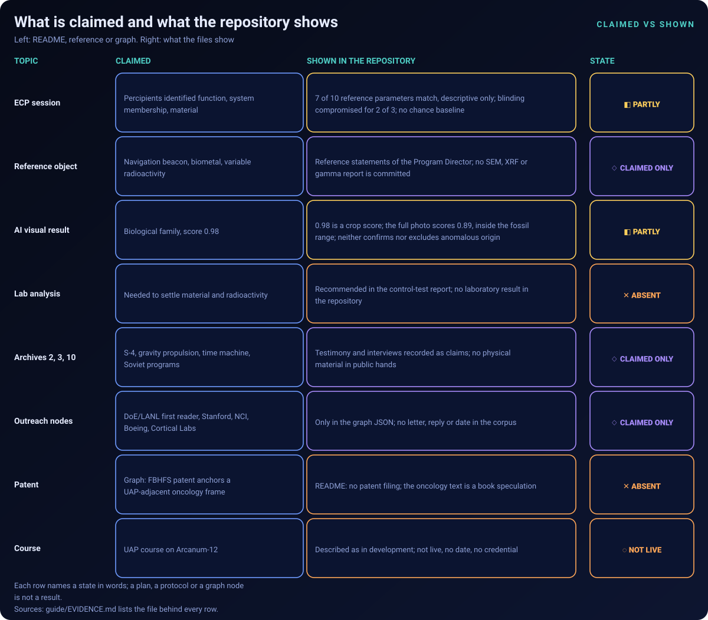
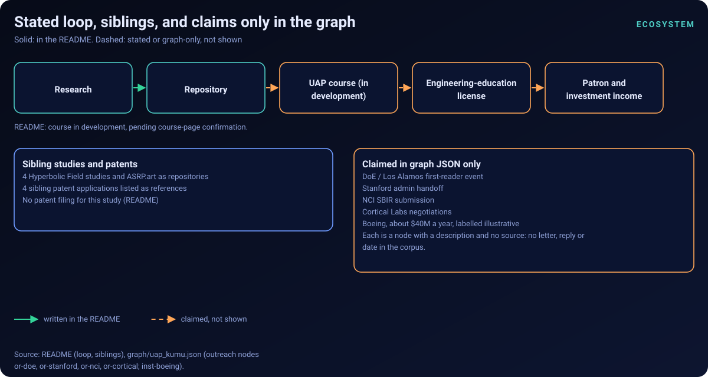

**English | [Русский](README.ru.md)**

<div align="center">



# UAP REVERSE ENGINEERING STUDY

**Reverse Engineering Hub — Multi-track research program**

| Repository | Status |
|---|---|
| `UAP_Reverse_Engineering_Study` | ACTIVE |

**Organization:** Advanced Scientific Research Projects (ASRP)

**Part of Advanced Scientific Research Projects (ASRP) Ecosystem**

[](https://github.com/AdvancedScientificResearchProjects)
[]()

[]()
<!-- badges -->


<!-- /badges -->

[](https://asrp.tech/en/patrons)

> **If this work is valuable to you — support us.** 7 patron tiers from Principal Philanthropist to Individual Contributor.
>
> **Support:** <https://asrp.tech/en/patrons><br>
> **Investment inquiries:** _pending — provide URL when available_

</div>

> This is a private, exploratory research hub. All findings are preliminary and subject to validation. One experiment, one session, three percipients, blinding compromised: the results are descriptive and are not a validation. No patent filing exists for this study.

<!-- legacy-anchors --><a name="uap-reverse-engineering-study"></a><a name="исследование-по-реверс-инжинирингу-ная"></a><a name="table-of-contents--содержание"></a><a name="navigation-index--навигационный-индекс"></a>
## At a glance

- **What it is.** A private multi-track hub of <!--n:tracks-->11<!--/n--> tracks and <!--n:files_total-->1517<!--/n--> tracked files that asks whether an unusual object (`UAP-FRAG-001`) can be studied by combining percipient reports, machine vision and archives, and which UAP origin narratives survive an evidence filter.
- **What it measured.** One Extended Cognitive Perception session (`<!--n:session_id-->ECP-2026-04-04<!--/n-->`) with <!--n:percipient_reports-->3<!--/n--> percipients: <!--n:ref_exact-->7<!--/n--> of <!--n:ref_params-->10<!--/n--> reference parameters match, <!--n:ref_partial-->2<!--/n--> partly, <!--n:ref_miss-->1<!--/n--> not at all. Blinding was compromised for <!--n:blinded_compromised_n-->2<!--/n--> of <!--n:percipient_reports-->3<!--/n-->, so the study itself says the counts do not show independent convergence.
- **What the AI said.** A <!--n:pipeline_stages-->10<!--/n-->-stage vision pipeline calls the object fossil-like. The headline SigLIP2 **<!--n:score_crop-->0.98<!--/n--> is a score on the cropped image; the full photograph scores <!--n:score_full-->0.89<!--/n-->**, inside the range of real echinoid fossils. The control test neither confirms nor excludes anomalous origin.
- **What the other ten tracks are.** Archives of public material (Lazar, Chernobrov, the JINR interview, Gershtein, PURSUE releases), an OSINT method layer, people and corporate layers, a synthesis and a literature catalog. They record claims; they do not validate them.
- **What is claimed but not shown.** Outreach to DoE/LANL, Stanford, NCI and Boeing appears only as nodes of the knowledge graph (claimed, not shown); the UAP course is not live; there is no patent, no OSF record, no laboratory analysis.
- **Where to start.** [Track 1](guide/EXPERIMENT.md) for the experiment, [Evidence](guide/EVIDENCE.md) for claimed versus shown, [Open questions](guide/OPEN.md) for what does not add up.

## Quick navigation

| &nbsp;&nbsp;Icon&nbsp;&nbsp; | Section | What is inside |
|:---:|---|---|
|  | **[The study](guide/STUDY.md)** | what the hub is, what it is not, the team, version and status |
|  | **[Tracks](guide/TRACKS.md)** | the <!--n:tracks-->11<!--/n--> tracks: archives of external material, analysis layers, literature catalog |
|  | **[Track 1: the experiment](guide/EXPERIMENT.md)** | the ECP session, blinding, responses against the reference, AI results |
|  | **[Evidence](guide/EVIDENCE.md)** | what is shown, claimed, not yet done; claims found only in the graph |
|  | **[ASRP ecosystem, IP and course](guide/ECOSYSTEM.md)** | the stated loop, patent connection, OSF, sibling repositories and patents |
|  | **[Navigation and structure](guide/NAVIGATION.md)** | where things are, reading routes, archive branches, the folder tree |
|  | **[Open questions](guide/OPEN.md)** | inconsistencies and what would settle the main questions |
|  | **[Ethics, IP and security](guide/ETHICS.md)** | classification, what is withheld, contact, disclaimer |

Full list: [guide index](guide/README.md).

**On this page:** [What this study is](#what-this-study-is) · [Research tracks](#research-tracks) · [Track 1](#track-1-the-experiment) · [The AI result](#the-ai-result-a-crop-score-not-the-headline) · [Claimed versus shown](#claimed-versus-shown) · [Ecosystem and IP](#asrp-ecosystem-ip-and-course) · [Team](#research-team) · [Structure](#navigation-and-structure) · [Open questions](#open-questions) · [Ethics](#ethics-ip-and-security) · [Contact](#contact) · [Disclaimer](#disclaimer)

---

<!-- legacy-anchors --><a name="overview--обзор"></a><a name="english"></a><a name="русский"></a>
## What this study is

<!-- excerpt STUDY 0 -->
This repository is a **Reverse Engineering Hub** — a multi-track research program coordinating several parallel investigations into UAP-class phenomena. The hub organizes primary observational archives, methodology layers, and cross-archive synthesis into a single navigable structure.

The artifact investigation around fragment **UAP-FRAG-001** (3-pipeline study: AI / archival / Extended Cognitive Perception) is **one** of these tracks — Track 1. It runs in parallel with historical archives (Bob Lazar, Vadim Chernobrov, Dubna / Element 115), a methodology layer (OSINT + Intelligence Analysis), a people-analysis cluster (the 11 scientists case consolidated by the FBI on 2026-04-19), a planned corporate / economic analysis layer, and the root-level cross-archive synthesis.

*Reading note.* The FBI consolidation date (2026-04-19) is repeated in the repository from a single-author YouTube recap; treat it as unverified here ([Open questions](guide/OPEN.md)).

The README of this repository used to be a single navigation hub with every track's story on one page; that front page is now split into short pages (see [Navigation and structure](guide/NAVIGATION.md)) and the previous README is kept byte for byte in [`archive/`](archive/README_2026-11-19_pre-showcase.md). Each track still has its own README with the full primary material.

**The question it asks.** Can an unusual object be studied by combining percipient reports, machine vision and archives, and which UAP origin narratives survive an evidence filter?

**What it is, in short.** A private, exploratory research hub of <!--n:tracks-->11<!--/n--> tracks and <!--n:files_total-->1517<!--/n--> tracked files. Its one experiment is a single Extended Cognitive Perception (ECP) session on one object, `UAP-FRAG-001`: <!--n:percipient_reports-->3<!--/n--> percipients described it before a later-disclosed <!--n:ref_params-->10<!--/n-->-parameter reference was compared with their answers. <!--n:ref_exact-->7<!--/n--> of <!--n:ref_params-->10<!--/n--> parameters match exactly, but the study's own report says the counts do not show independent convergence, because blinding was compromised for <!--n:blinded_compromised_n-->2<!--/n--> of <!--n:percipient_reports-->3<!--/n--> percipients. The other ten tracks are curated archives of public material (testimony, interviews, declassified records, literature) and a methodology layer; they record claims without validating them.
<!-- /excerpt -->

Full page: [The study](guide/STUDY.md)

---

<!-- legacy-anchors --><a name="research-tracks--исследовательские-треки"></a><a name="track-2--трек-2--bob-lazar-archive--архив-боба-лазара"></a><a name="track-3--трек-3--vadim-chernobrov-archive--архив-вадима-черноброва"></a><a name="track-4--трек-4--dubna--element-115--дубна--элемент-115"></a><a name="track-5--трек-5--osint--intelligence-analysis--osint-и-разведывательный-анализ"></a><a name="track-6--трек-6--people-analysis--анализ-людей"></a><a name="track-7--трек-7--corporate--economic-analysis--корпоративный--экономический-анализ"></a><a name="fuel-supply-chain-hypothesis-v4--гипотеза-цепочки-топливоснабжения-v4"></a><a name="track-8--трек-8--cross-archive-synthesis--кросс-архивный-синтез"></a><a name="track-9--трек-9--uap-scientific-publications-corpus--корпус-научных-публикаций-по-uap"></a><a name="track-10--трек-10--gershtein-archive--архив-герштейна"></a><a name="track-11--трек-11--pursue-declassification--рассекречивание-pursue"></a>
## Research tracks

<!-- excerpt TRACKS 0 -->
<div align="center">
<a href="guide/assets/diagrams/tracks-map.en.svg"></a>
</div>

| Track | Subject | Status | Lead file |
|---|---|---|---|
| **1. Artifact investigation** | UAP-FRAG-001 ECP+AI multi-pipeline | Available | [Track 1](guide/EXPERIMENT.md) |
| **2. Bob Lazar archive** | Lazar interview corpus 1989–2026 (S-4, element 115, gravity propulsion) | Available | [`bob-lazar-archive/README.md`](bob-lazar-archive/README.md) |
| **3. Vadim Chernobrov archive** | Kosmopoisk Russian field research 1988–2017 (time-machine, anomalous zones) | Available | [`chernobrov-archive/README.md`](chernobrov-archive/README.md) |
| **4. Dubna / Element 115** | ASRP.media JINR+LLNL interview, moscovium synthesis 2003 | Available | [`dubna-element-115-analysis/README.md`](dubna-element-115-analysis/README.md) |
| **5. OSINT + Intelligence Analysis** | Methodology layer — signature analysis, anomaly classification, validation pipeline | Available | [`osint-intelligence-analysis/README.md`](osint-intelligence-analysis/README.md) |
| **6. People analysis** | 11 scientist deaths/disappearances cluster (FBI 2026-04-19 announcement) | Available | [`people-analysis/README.md`](people-analysis/README.md) |
| **7. Corporate / economic analysis** | EG&G → Amentum corporate genealogy + 4 engineering primes + 2 HSP-scanned Amentum executives + Honeywell + EG&G historical sub-units + 11-inventor patents inventory + theoretical-foundations sub-archive (Morgan / Frolov / scalar-vortex literature) | Available | [`corporate-economic-analysis/README.md`](corporate-economic-analysis/README.md) |
| **8. Cross-archive synthesis** | Themes spanning multiple tracks | Available | [`analysis/cross-archive-synthesis.md`](analysis/cross-archive-synthesis.md) |
| **9. UAP scientific publications corpus** | Public-source literature catalog: peer-reviewed UAP physics + social-science + government reports + observation-program technical outputs | Available | [`uap-scientific-publications/README.md`](uap-scientific-publications/README.md) |
| **10. Gershtein archive** | Mikhail Gershtein interview corpus (~62 interviews), Soviet UAP research programs, plasma phenomena, NDE/UAP cross-references | Available | [`gershtein-archive/README.md`](gershtein-archive/README.md) |
| **11. PURSUE Declassification** | DoW/FBI/NASA/State/**CIA/DOE/ODNI** UAP records — Release 01 (161 records, 2026-05-08) + **Release 02 (64 records, 2026-05-22)** = **225 total**: 127 PDFs + 79 mp4/aud + 14 jpg; 164 per-doc cards, 8 topical syntheses, MASTER extended (§§12–14 for R02); 0 source-code overlap between releases; new agencies **CIA / DOE / ODNI** introduced in R02 | Available | [`war-gov-pursue-archive/README.md`](war-gov-pursue-archive/README.md) |

The tracks index above is the central navigation. Each track is independent: open the lead file to enter that track's primary material. All eleven tracks are now available, each with content in the repository; Track 1 and Track 8 live in root folders (`analysis/`, `reports/`, `experiments/`, `pipeline/`, `data/`, `charts/`), the other nine have their own folder. Only Track 1 is an experiment.
<!-- /excerpt -->

Full page: [Tracks](guide/TRACKS.md)

---

<!-- legacy-anchors --><a name="track-1--трек-1--artifact-investigation-uap-frag-001--исследование-артефакта-uap-frag-001"></a><a name="en"></a><a name="ru"></a><a name="track-1-sub-sections--подразделы-трека-1"></a><a name="research-at-a-glance--исследование-в-цифрах"></a><a name="research-overview--обзор-исследования"></a><a name="key-metrics--ключевые-метрики"></a><a name="working-hypotheses--рабочие-гипотезы"></a><a name="visual-evidence--визуализация-данных"></a><a name="response-agreement-map--карта-согласованности-ответов"></a><a name="reference-validation-map--карта-валидации-по-референсу"></a><a name="session-blinding-sequence--схема-ослепления-сеанса"></a><a name="evidence-synthesis-flow--схема-синтеза-доказательств"></a><a name="research-pipelines--исследовательские-конвейеры"></a>
## Track 1: the experiment

<!-- excerpt EXPERIMENT 0 -->
One object (`UAP-FRAG-001`), one percipient session, a <!--n:pipeline_stages-->10<!--/n-->-stage computer-vision pipeline and a control test. The numbers below are the previous README's table; the right-hand column says what kind of number each is.

| Parameter | Value | Status |
|---|---|---|
| **Artifact ID** | `UAP-FRAG-001` | Active case |
| **Primary ECP session** | `ECP-2026-04-04` | Completed |
| **Recorded percipient reports** | 3 | Available |
| **Verifiable reference parameters** | 10 | Validated (the Russian text says "compared") |
| **Exact matches** | 7/10 | Descriptive |
| **Partial or indirect matches** | 2/10 | Descriptive |
| **Complete misses** | 1/10 | Descriptive |
| **Repeated themes across all 3 responses** | 4 | Descriptive |
| **Known methodological limitation** | Compromised blinding for 2 later percipients | Critical |
| **Protocol version** | 2.0 | Synchronized |

<div align="center">
<a href="guide/assets/diagrams/ecp-validation.en.svg"></a>
</div>

**Key metrics.**

| Metric | Value | Interpretation |
|---|---|---|
| **Percipient count** | 3 | Small exploratory session |
| **All-response repeated themes** | 4 | Beacon-like function, larger system, no consciousness, non-terrestrial origin |
| **Exact-or-partial coverage** | 9/10 | Broad descriptive overlap with disclosed reference |
| **Direct contradiction count** | 1 | Flight vs stationary placement |
| **Undetected reference property** | 1 | Variable radioactivity |
| **Later percipients with compromised blinding** | 2/3 | Limits independent interpretation |

The current Track 1 material is strongest where it separates raw percipient records, descriptive overlap analysis, and later validation against disclosed reference data.

The study's own validation report states the limit in one sentence: "These counts are descriptive only and do not establish independent convergence because blinding was compromised for two percipients." No chance baseline is computed; the ECP protocol carries only an empty true-positive / false-positive template (`experiments/protocol_ecp.md`).
<!-- /excerpt -->

Full page: [Track 1: the experiment](guide/EXPERIMENT.md)

---

<!-- legacy-anchors --><a name="ai--cv-analysis-results--результаты-ии--cv-анализа"></a><a name="ai-pipeline-summary--сводка-конвейера-ии"></a><a name="key-ai-findings--ключевые-результаты-ии"></a><a name="timeline--временная-шкала"></a>
## The AI result: a crop score, not the headline

<!-- excerpt EXPERIMENT 3 -->
A <!--n:pipeline_stages-->10<!--/n-->-stage pipeline (`pipeline/`) runs on one photograph of the artifact: preprocessing, detection (Grounding DINO), segmentation (SAM2), features (DINOv2), material families (SigLIP2), two anomaly detectors (EfficientAD, CLIP) and depth (Depth-Anything), then a report stage. Its stage outputs (<!--n:pipeline_outputs-->11<!--/n--> JSON files) are committed in `data/processed/`. The original source photograph `data/raw/UAP-FRAG-001.jpg` is not in the repository (Issue #4); a copy sits in `data/raw/control-images/`.

**Key AI findings.**

| Finding | Confidence | Method | Report |
|---|---|---|---|
| Biological/coral material family | 0.98 sigmoid (cropped image) | SigLIP2 | [AI-2026-04-07-001](reports/ai_reports/AI-2026-04-07-001.md) |
| Sea urchin fossil (Cidaridae) visual match | High | LLM visual | [AI-2026-04-07-001-llm](reports/ai_reports/AI-2026-04-07-001-llm-visual.md) |
| No surface anomalies detected | Expected | EfficientAD + CLIP | [AI-2026-04-07-001](reports/ai_reports/AI-2026-04-07-001.md) |
| Converges with ECP data ("coral-like") | Cross-method | AI + ECP | [Cross-comparison](analysis/cross_comparison.md) |

> **Limitation:** RGB analysis cannot determine chemical composition, alloy type, or radioactivity. See [AI Protocol v3.1](experiments/protocol_ai.md#limitations--ограничения).

**The 0.98 is a crop score; the full photograph scores 0.89.** The 0.98 belongs to the cropped artifact image at pipeline stage 5. The control test of 2026-04-09 (`reports/ai_reports/AI-2026-04-09-control-test.md`) re-scored the full photograph: <!--n:score_full4-->0.8912<!--/n-->. It compared the artifact with <!--n:control_images-->13<!--/n--> control images in three groups (similar echinoid fossils, dissimilar biological specimens, non-biological objects). Against the <!--n:control_n_similar-->5<!--/n--> similar fossils (mean <!--n:fossil_mean-->0.7320<!--/n-->, standard deviation <!--n:fossil_std-->0.1738<!--/n-->) the artifact has Z = <!--n:fossil_z-->0.916<!--/n-->, the <!--n:fossil_pct-->80<!--/n-->th percentile, so it is not statistically distinguishable from them; the nearest dark fossil scores <!--n:score_nearest_fossil-->0.9870<!--/n-->, above the artifact. It lies far above the negative controls (maximum <!--n:score_max_negative-->0.023<!--/n-->). The test lists five limitations (small sample, mixed image sources, no identical-condition controls, one model, RGB only) and ends: "The control test neither confirms nor excludes anomalous origin." Laboratory analysis (SEM-EDS, XRF, gamma spectroscopy) is recommended and not in the repository.

<div align="center">
<a href="guide/assets/diagrams/ai-control.en.svg"></a>
</div>

The previous README states the visual finding as "Biological/coral material family" with confidence 0.98 and says the AI result "converges" with the percipients' "coral-like"; given the blinding and the control test, read both as description of appearance, not as evidence of origin or composition.
<!-- /excerpt -->

Full page: [Track 1: the experiment](guide/EXPERIMENT.md)

---

## Claimed versus shown

<!-- excerpt EVIDENCE 0 -->
<div align="center">
<a href="guide/assets/diagrams/claimed-vs-shown.en.svg"></a>
</div>

The one experiment in this study gives a **descriptive overlap**, not a validation: <!--n:ref_exact-->7<!--/n--> of <!--n:ref_params-->10<!--/n--> reference parameters match, <!--n:ref_partial-->2<!--/n--> partly and <!--n:ref_miss-->1<!--/n--> not at all, while blinding was compromised for <!--n:blinded_compromised_n-->2<!--/n--> of <!--n:percipient_reports-->3<!--/n--> percipients and there is no chance baseline. The AI pipeline classifies the artifact photo as looking like a fossil: the headline 0.98 is a crop score, the full photo scores 0.89 and sits inside the range of real echinoid fossils. The ten other tracks record claims and public records; none of that is validated here. The repository's own words for the limit: the control test "neither confirms nor excludes anomalous origin"; the ECP is "a structured hypothesis-generation tool", not validation.

Every row below names the file it comes from (paths of the previous README point to the archived copy, `archive/README_2026-11-19_pre-showcase.md`, whose line numbers are the old ones).
<!-- /excerpt -->

Full page: [Evidence](guide/EVIDENCE.md)

---

<!-- legacy-anchors --><a name="educational-program--образовательная-программа"></a><a name="what-this-section-does-not-claim--чего-эта-секция-не-утверждает"></a><a name="osf-preregistration--предварительная-регистрация-osf"></a><a name="patent-connection--связь-с-патентом"></a><a name="asrp-ecosystem--экосистема-asrp"></a><a name="related-research-repositories--связанные-исследовательские-репозитории"></a><a name="patent-portfolio--патентный-портфель"></a>
## ASRP ecosystem, IP and course

<!-- excerpt ECOSYSTEM 0 -->
<div align="center">
<a href="guide/assets/diagrams/ecosystem-claims.en.svg"></a>
</div>

ASRP's UAP-reverse-engineering research is paired with an **educational program** at the **Arcanum-12 platform** ([`https://arcanum12th.education`](https://arcanum12th.education)). A dedicated **UAP reverse-engineering course** is in development — status: pending course-page confirmation. The educational program is **part of the project commercialization model**: research → repository → course → engineering-education license → bundled microelectronics + embedded-systems courses → advanced UAP reverse-engineering materials. Patron and investment income closes the loop, sustaining the research-and-publication pipeline.

The companion ecosystem-marketing repository (`ASRP_ecosystem_marketing/`) documents the full ASRP commercialization architecture including Arcanum-12, GFS, ASRP.media, and the Kapusta rating substrate. This UAP-research repository contributes the **research-and-publication track** of that architecture.

**What this section does NOT claim**

- Does **NOT** assert the UAP reverse-engineering course is currently live and enrolling students.
- Does **NOT** claim completion-credentials are currently available.
- Does **NOT** promise a specific delivery date for the course.
- Does **NOT** assert that course completion grants any specialised authorisation.

The hub never names a course repository, and no course page is linked. The loop above is a stated model, not a result; the statements about outreach in the graph are listed separately under [Evidence](guide/EVIDENCE.md#claims-found-only-in-the-graph).
<!-- /excerpt -->

Full page: [Ecosystem, IP and course](guide/ECOSYSTEM.md)

---

<!-- legacy-anchors --><a name="research-team--исследовательская-команда"></a><a name="hsp-group--группа-вскч"></a>
## Research team

<!-- excerpt STUDY 2 -->
The README names six team members; roles and responsibilities are as the previous README gave them.

| Name | Role | Responsibilities |
|---|---|---|
| **Ovsyannikova Valeria** | Director of Biomedical Research Department | Reverse engineering, partial reproduction of individual device functions, subject control |
| **Savelyev Ivan** | Science Director & Editor-in-Chief of ASRP.science | Scientific methodology, peer review |
| **Kapustin Mykhailo** | CTO & Director of AI and IT Department | AI infrastructure, IT systems |
| **Zmiienko Kyryl** | Chief AI Engineer | AI analysis, data validation, ECP protocol design |
| **Ovsyannikov Alexandr** | IT Specialist | IT support |
| **Banchenko Denis** | Program Director, Author of Research Methodology & Technology | Project coordination, methodology design |

### HSP group

HSP group (high-sensitivity cognitive percipients) involved in object-based psychometric information acquisition protocols.

Three percipients took part in the one recorded session. Their names are not given on these pages (PII, memory-policy); the primary reports in the repository are linked from [Track 1](guide/EXPERIMENT.md).
<!-- /excerpt -->

Full page: [The study](guide/STUDY.md)

---

<!-- legacy-anchors --><a name="structure--структура"></a>
## Navigation and structure

<!-- excerpt NAVIGATION 0 -->
The tree is generated from the repository's real file list (`tools/tree.py`); counts are computed.

<!-- tree -->
```
ASRP_UAP_Reverse_Engineering_Study/
├── README.md                       # front page (English)
├── README.ru.md                    # front page (Russian)
├── guide/                          # detail pages X.md + X.ru.md; assets/ = generated SVG
├── archive/                        # the previous README, kept byte for byte
├── tools/                          # showcase tooling: facts, visuals, excerpts, no-loss check
├── tests/                          # regression gate for the showcase
├── analysis/                       # Track 8 and Track 1 analysis at the root: synthesis, taxonomy, ECP validation
│   ├── cross-archive-synthesis.md  # Track 8: overlaps between Lazar, Chernobrov, Dubna
│   ├── uap-taxonomy.md             # Track 8: three-category origin vocabulary
│   ├── external-podcasts.md        # Track 8: external podcasts and documentaries
│   ├── cross_comparison.md         # Track 1: descriptive overlap of the responses
│   └── ecp_validation_report.md    # Track 1: responses against the disclosed reference
├── experiments/                    # protocols: ECP, AI pipeline, corporate scan
├── reports/                        # Track 1 reports
│   ├── percipient_reports/         # 3 session reports (percipients not named on these pages)
│   └── ai_reports/                 # 3 AI reports: CV pipeline, LLM visual, control test
├── pipeline/                       # Track 1 code: 10 stages (detect, segment, features, SigLIP2, anomaly, depth)
├── data/                           # Track 1 data: 11 stage outputs, control images, sketches inventory
├── charts/                         # Track 1 charts: two ECP matrices and Mermaid renders
├── mermaid/                        # Mermaid sources and renders of the archive tracks (9 folders)
├── bob-lazar-archive/              # Track 2: 26 transcripts, analysis, catalog
├── chernobrov-archive/             # Track 3: 22 transcripts, analysis, books
├── dubna-element-115-analysis/     # Track 4: JINR interview, claims, 9 diagrams
├── osint-intelligence-analysis/    # Track 5: method layer, 5 pages
├── people-analysis/                # Track 6: 11 public-source profiles
├── corporate-economic-analysis/    # Track 7: companies, analysis, theoretical foundations
├── uap-scientific-publications/    # Track 9: 49 pages of literature catalog
├── gershtein-archive/              # Track 10: 62 transcripts, articles, books
├── war-gov-pursue-archive/         # Track 11: 222 cards, 10 topical files, MASTER claims
├── graph/                          # knowledge graph: 499 nodes, 896 links
│   ├── README.md                   # how to build and view (its own numbers are stale)
│   ├── build_blueprint.py          # builds the JSON from fragments
│   ├── fragments/                  # per-track entity extractions
│   ├── uap_kumu.json               # generated graph
│   └── preview.html                # browser viewer
├── docs/                           # placeholder (empty)
└── hardware/                       # placeholder (empty)
```
<!-- /tree -->

Notes. `mermaid/` (<!--n:mermaid_folders-->9<!--/n--> sub-folders, <!--n:mermaid_png-->60<!--/n--> rendered PNG) holds the Mermaid sources and renders of the archive tracks and was not in the previous README's tree. `docs/` and `hardware/` contain only placeholders. The three percipient reports in `reports/percipient_reports/` carry participant names; these pages do not name them.

**Folders as the previous README described them** (its own wording and counts; the tree above has the counts computed from the files).

| Folder | Described as |
|---|---|
| `analysis/` | Cross-archive synthesis (Track 8); the Track 1 cross comparison and ECP validation report also live here |
| `dubna-element-115-analysis/` | Track 4; 9 rendered diagrams |
| `osint-intelligence-analysis/` | Track 5 (methodology); 4 analysis files; 4 diagrams |
| `people-analysis/` | Track 6 (11 scientists cluster); 3 analysis files (Cardillo / FBI / cluster summary); 11 per-person files; 5 diagrams; raw: YouTube transcript (public) |
| `corporate-economic-analysis/` | Track 7 (defense-prime constellation); 8 analysis files + `adversarial-osint-runs/`; 8 company profiles + index (incl. Honeywell); 2 HSP scan dossiers (depersonalized) + public scanning roster (27 entries); `theoretical-foundations/` v3 sub-archive (Morgan / Frolov / scalar-vortex literature catalog); 9 diagrams (3 v1 + 4 v3 + 2 v4) |
| `uap-scientific-publications/` | Track 9 (v4); 6 analysis files (taxonomy / peer-reviewed physics / peer-reviewed social / grey lit / govt reports / observation programs); 13 source-provenance files (Kean, Pasulka, Eghigian, Wendt-Duvall, NASA, ODNI, AARO, Hessdalen, Nimitz, Galileo, SCU + 2 cross-refs); raw Perplexity research dumps (tool output) |
| `experiments/` | Track 1 + Track 7 protocols: ECP protocol v2.0, AI protocol v3.1, corporate HSP scan protocol v1.2 |
| `data/` | Track 1 research data: raw input data and pipeline output |
<!-- /excerpt -->

Full page: [Navigation and structure](guide/NAVIGATION.md)

---

## Open questions

<!-- excerpt OPEN 0 stop=^\|.6.\| -->
Inconsistencies inside the repository are listed here and not corrected: the source files are unchanged. "Not verified" marks items that rest on a source outside this repository.

| # | Item | What the files say | Where |
|---|---|---|---|
| 1 | Graph statistics | `graph/README.md` says 275 entities, 447 links, 64 facts; the JSON has <!--n:graph_nodes-->499<!--/n--> elements, <!--n:graph_edges-->896<!--/n--> connections, <!--n:graph_facts-->83<!--/n--> facts. Its tracks table also still calls Track 7 a placeholder while the README lists it as available | `graph/README.md`, `graph/uap_kumu.json` |
| 2 | PURSUE counts | Previous README: 164 per-document cards, 8 topical syntheses, 6362 lines in MASTER; the track README mixes Release 01 only (158 cards, 7 topicals, 161 records) with both releases (225); files on disk: <!--n:pursue_cards-->222<!--/n--> per-document, <!--n:pursue_topical-->10<!--/n--> topical, MASTER <!--n:pursue_master_lines-->9306<!--/n--> lines | `war-gov-pursue-archive/README.md`, `archive/README_2026-11-19_pre-showcase.md` |
| 3 | Lazar counts | "Unique appearances: 24" against "25 main + 1 external" transcript files; <!--n:lazar_transcripts-->26<!--/n--> transcript files on disk | `bob-lazar-archive/` |
| 4 | Stale Russian sentence | The Russian text of the previous README says all ten active tracks are available and Track 10 is reserved; the table lists eleven, and Track 10 has <!--n:gershtein_transcripts-->62<!--/n--> transcripts | `archive/README_2026-11-19_pre-showcase.md` |
| 5 | Blinding is worse than "2 of 3" | The validation report also records the first percipient as only partly blind (saw the object earlier without explanation) | `analysis/ecp_validation_report.md` |
<!-- /excerpt -->

Full page: [Open questions](guide/OPEN.md)

---

<!-- legacy-anchors --><a name="security--безопасность"></a><a name="data-classification--классификация-данных"></a>
## Ethics, IP and security

<!-- excerpt ETHICS 0 -->
| Level | Access | Marking | Description |
|---|---|---|---|
| **PUBLIC** | Open | GREEN | General information |
| **RESEARCH** | Team Only | YELLOW | Research data |
| **RESTRICTED** | Core Team | RED | Sensitive analysis |
| **INTERNAL** | Director Only | BLACK | Director-level review only |

**What is withheld on these pages.** The three percipients are not named and no per-person data is shown; their matrices are redrawn as P1 to P3. The primary percipient reports and the sketch inventory carry names and personal impressions and stay in the repository; the sketches may not be reproduced outside the ECP study without consent. The per-person files of Track 6 (private persons) and the HSP scan dossiers of Track 7 (public executives, described as subjective percipient observations) are not summarised. No personal e-mail addresses appear. The FBI consolidation date and similar claims are marked as unverified where they are repeated.
<!-- /excerpt -->

Full page: [Ethics, IP and security](guide/ETHICS.md)

---

<!-- legacy-anchors --><a name="contact-information--контактная-информация"></a><a name="corporate-contact--корпоративные-контакты"></a>
## Contact

<!-- excerpt ETHICS 1 -->
### Corporate Contact

| Field | Value |
|---|---|
| **Organization** | ТОО "Перспективные Научно-Исследовательские Разработки" / Advanced Scientific Research Projects LLP |
| **Address** | Baikonur, 468320 |
| **Country** | Republic of Kazakhstan |
| **Website** | [asrp.tech](https://asrp.tech) |
| **Email** | info@asrp.tech |

| Purpose | Contact |
|---|---|
| **General Inquiries** | info@asrp.tech |
| **Research Collaboration** | info@asrp.tech |
| **Security Issues** | info@asrp.tech |
<!-- /excerpt -->

Full page: [Support and contact](guide/ETHICS.md)

---

<!-- legacy-anchors --><a name="disclaimer--отказ-от-ответственности"></a><a name="english-1"></a><a name="русский-1"></a>
## Disclaimer

<!-- excerpt ETHICS 2 -->
This research operates at the boundary of known science, experimental methodologies, and non-standard perception studies. All findings are preliminary and subject to validation.

**Last Updated:** July 2026
**Version:** 3.0 (Hub structure)
**Status:** ACTIVE

**ASRP RESEARCH STANDARD v2.1**

This repository is private and exploratory. Nothing on these pages is a validated result, a granted patent, a medical or engineering claim, or a statement that any named person or company took part in UAP reverse engineering.
<!-- /excerpt -->

Full page: [Ethics, IP and security](guide/ETHICS.md)
