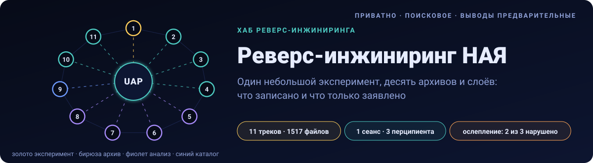
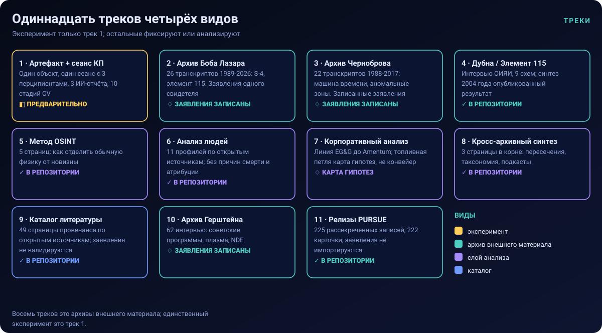
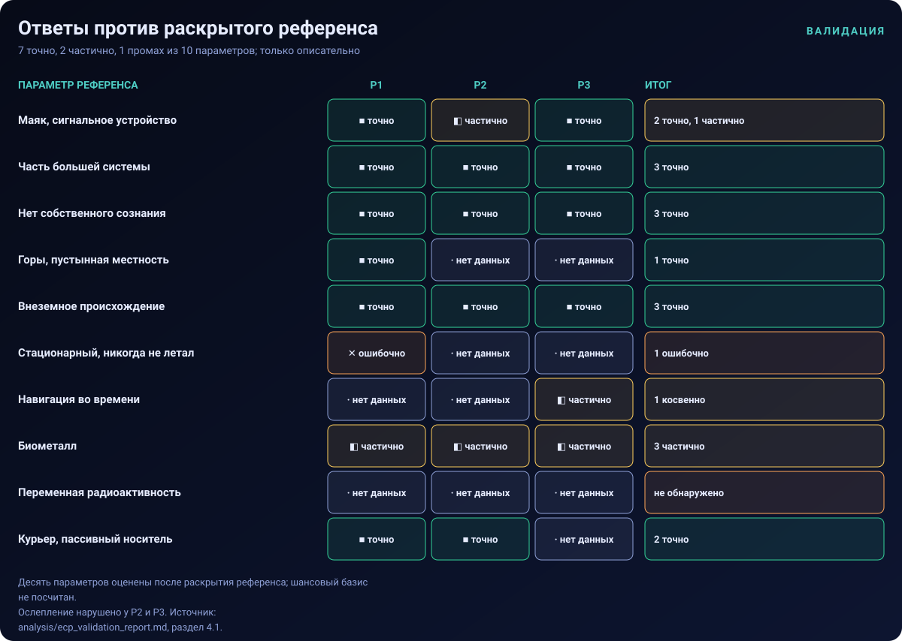
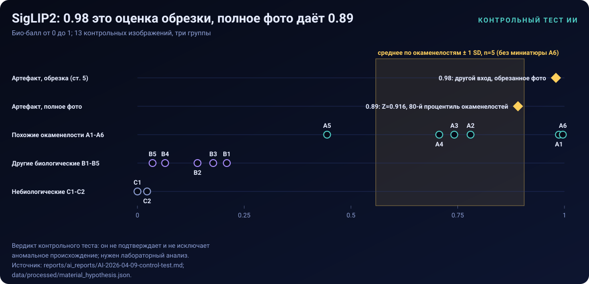
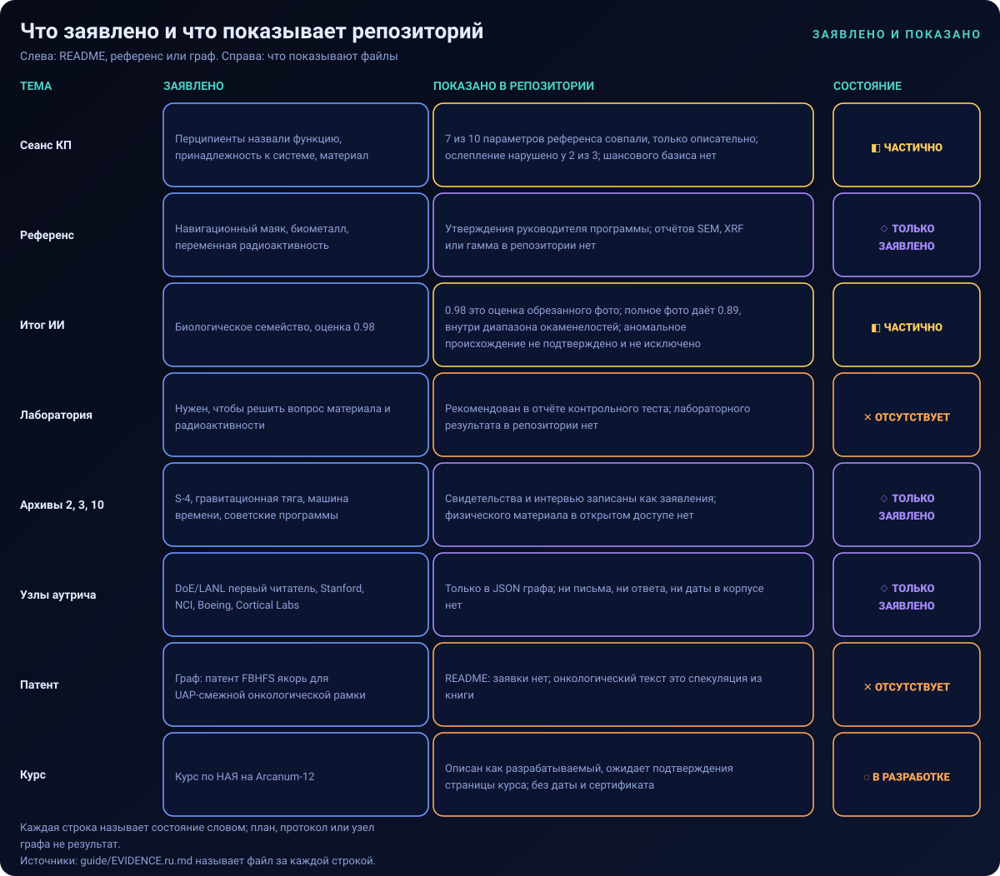

**[English](README.md) | Русский**

<div align="center">



# ИССЛЕДОВАНИЕ ПО РЕВЕРС-ИНЖИНИРИНГУ НАЯ

**Хаб реверс-инжиниринга — многотрековая исследовательская программа**

| Репозиторий | Статус |
|---|---|
| `UAP_Reverse_Engineering_Study` | АКТИВЕН |

**Организация:** Advanced Scientific Research Projects (ASRP)

**Часть экосистемы ASRP**

[](https://github.com/AdvancedScientificResearchProjects)
[]()

[]()
<!-- badges -->


<!-- /badges -->

[](https://asrp.tech/en/patrons)

> **Если эта работа вам полезна — поддержите нас.** 7 уровней меценатства — от Главного Филантропа до Индивидуального Вкладчика.
>
> **Поддержать:** <https://asrp.tech/en/patrons><br>
> **Инвестиционные запросы:** _в ожидании — добавляется при предоставлении_

</div>

> Это поисковый исследовательский хаб. Все выводы предварительные и подлежат валидации. Один эксперимент, один сеанс, три перципиента, ослепление нарушено: результаты описательные и не являются валидацией. Заявки на патент по этому исследованию нет.

<!-- legacy-anchors -->
## Коротко

- **Что это.** Многотрековый хаб из <!--n:tracks-->11<!--/n--> треков и <!--n:files_ru-->1517 файлов<!--/n--> под учётом git, который спрашивает, можно ли изучать необычный объект (`UAP-FRAG-001`), сочетая отчёты перципиентов, машинное зрение и архивы, и какие нарративы о происхождении НАЯ выдерживают фильтр доказательств.
- **Что измерено.** Один сеанс Расширенного Когнитивного Восприятия (<!--n:session_id-->ECP-2026-04-04<!--/n-->) с <!--n:percipient_reports-->3<!--/n--> перципиентами: <!--n:ref_exact-->7<!--/n--> из <!--n:ref_params-->10<!--/n--> параметров референса совпали, <!--n:ref_partial-->2<!--/n--> частично, <!--n:ref_miss-->1<!--/n--> не совпал. Ослепление нарушено у <!--n:blinded_compromised_n-->2<!--/n--> из <!--n:percipient_reports-->3<!--/n-->, поэтому исследование само говорит, что эти числа не показывают независимой конвергенции.
- **Что сказал ИИ.** Конвейер зрения из <!--n:pipeline_stages-->10<!--/n--> стадий называет объект похожим на окаменелость. Заглавная оценка SigLIP2 **<!--n:score_crop-->0.98<!--/n--> относится к обрезанному изображению; полная фотография даёт <!--n:score_full-->0.89<!--/n-->**, внутри диапазона настоящих окаменелостей эхиноидов. Контрольный тест не подтверждает и не исключает аномальное происхождение.
- **Чем являются остальные десять треков.** Архивы публичного материала (Лазар, Чернобров, интервью ОИЯИ, Герштейн, релизы PURSUE), методологический слой OSINT, слои людей и корпораций, синтез и каталог литературы. Они фиксируют заявления, но не валидируют их.
- **Что заявлено, но не показано.** Аутрич в DoE/LANL, Stanford, NCI и Boeing виден только как узлы графа знаний (заявлено, не показано); репозиторий не утверждает, что курс по НАЯ запущен (указано: в разработке, ожидает подтверждения страницы курса); нет ни патента, ни записи OSF, ни лабораторного анализа.
- **С чего начать.** [Трек 1](guide/EXPERIMENT.ru.md) для эксперимента, [Доказательства](guide/EVIDENCE.ru.md) для «заявлено и показано», [Открытые вопросы](guide/OPEN.ru.md) для того, что не сходится.

## Быстрая навигация

| &nbsp;&nbsp;Иконка&nbsp;&nbsp; | Раздел | Что внутри |
|:---:|---|---|
|  | **[Исследование](guide/STUDY.ru.md)** | что это за хаб, чем он не является, команда, версия и статус |
|  | **[Треки](guide/TRACKS.ru.md)** | <!--n:tracks-->11<!--/n--> треков: архивы внешнего материала, слои анализа, каталог литературы |
|  | **[Трек 1: эксперимент](guide/EXPERIMENT.ru.md)** | сеанс КП, ослепление, ответы против референса, результаты ИИ |
|  | **[Доказательства](guide/EVIDENCE.ru.md)** | что показано, заявлено, ещё не сделано; утверждения только из графа |
|  | **[Экосистема ASRP, ИС и курс](guide/ECOSYSTEM.ru.md)** | заявленный контур, связь с патентом, OSF, родственные репозитории и патенты |
|  | **[Навигация и структура](guide/NAVIGATION.ru.md)** | где что лежит, маршруты чтения, архивные ветки, дерево папок |
|  | **[Открытые вопросы](guide/OPEN.ru.md)** | несоответствия и что решило бы главные вопросы |
|  | **[Галерея рисунков](guide/FIGURES.ru.md)** | все рисунки репозитория, по строке на каждый, с перерисованными схемами |
|  | **[Этика, ИС и безопасность](guide/ETHICS.ru.md)** | классификация, что скрыто, контакты, отказ от ответственности |

Полный список: [индекс руководства](guide/README.ru.md).

**На этой странице:** [Что это](#что-это-за-исследование) · [Треки](#исследовательские-треки) · [Трек 1](#трек-1-эксперимент) · [Результат ИИ](#результат-ии-оценка-обрезки-а-не-главная-цифра) · [Заявлено и показано](#заявлено-и-показано) · [Экосистема и ИС](#экосистема-asrp-ис-и-курс) · [Команда](#исследовательская-команда) · [Структура](#навигация-и-структура) · [Открытые вопросы](#открытые-вопросы) · [Этика](#этика-ис-и-безопасность) · [Контакты](#контакты) · [Отказ](#отказ-от-ответственности)

---

## Что это за исследование

<!-- excerpt STUDY 0 -->
Этот репозиторий — **Хаб реверс-инжиниринга**: многотрековая исследовательская программа, координирующая несколько параллельных направлений изучения явлений класса НАЯ. Хаб организует первичные наблюдательные архивы, методологические слои и кросс-архивный синтез в единую навигируемую структуру.

Исследование артефакта **UAP-FRAG-001** (трёхконвейерное: ИИ / архивный / Расширенное Когнитивное Восприятие) — **один** из этих треков, Трек 1. Он идёт параллельно с историческими архивами (Боб Лазар, Вадим Чернобров, Дубна / Элемент 115), методологическим слоем (OSINT и разведывательный анализ), кластером людей (дело 11 учёных, консолидированное ФБР 19.04.2026), запланированным слоем корпоративного / экономического анализа и корневым кросс-архивным синтезом.

*Примечание к прочтению.* Дата консолидации ФБР (19.04.2026) повторена в репозитории по пересказу одного автора на YouTube; здесь её следует считать непроверенной ([Открытые вопросы](guide/OPEN.ru.md)).

Прежний README был единым навигационным хабом, где история каждого трека лежала на одной странице; теперь титульная страница разбита на короткие страницы (см. [Навигация и структура](guide/NAVIGATION.ru.md)), а прежний README сохранён байт в байт в [`archive/`](archive/README_2026-11-19_pre-showcase.md). У каждого трека по-прежнему есть свой README с полным первичным материалом.

**Какой вопрос ставится.** Можно ли изучать необычный объект, сочетая отчёты перципиентов, машинное зрение и архивы, и какие нарративы о происхождении НАЯ выдерживают фильтр доказательств?

**Коротко, что это.** Поисковый исследовательский хаб из <!--n:tracks-->11<!--/n--> треков и <!--n:files_ru-->1517 файлов<!--/n--> под учётом git. Единственный эксперимент: один сеанс Расширенного Когнитивного Восприятия (КП) по одному объекту, `UAP-FRAG-001`: <!--n:percipient_reports-->3<!--/n--> перципиента описали его до того, как их ответы сравнили с раскрытым позже референсом из <!--n:ref_params-->10<!--/n--> параметров. <!--n:ref_exact-->7<!--/n--> из <!--n:ref_params-->10<!--/n--> параметров совпали точно, но отчёт самого исследования говорит, что эти числа не показывают независимой конвергенции, потому что ослепление нарушено у <!--n:blinded_compromised_n-->2<!--/n--> из <!--n:percipient_reports-->3<!--/n--> перципиентов. Остальные десять треков: курируемые архивы публичного материала (свидетельства, интервью, рассекреченные записи, литература) и методологический слой; они фиксируют заявления, не валидируя их.
<!-- /excerpt -->

Полная страница: [Исследование](guide/STUDY.ru.md)

---

## Исследовательские треки

<!-- excerpt TRACKS 0 -->
<div align="center">
<a href="guide/assets/diagrams/tracks-map.ru.svg"></a>
</div>

| Трек | Предмет | Статус | Главный файл |
|---|---|---|---|
| **1. Исследование артефакта** | мульти-конвейер КП+ИИ для UAP-FRAG-001 | Доступно | [Трек 1](guide/EXPERIMENT.ru.md) |
| **2. Архив Боба Лазара** | Корпус интервью Лазара 1989–2026 (S-4, элемент 115, гравитационная силовая установка) | Доступно | [`bob-lazar-archive/README.md`](bob-lazar-archive/README.md) |
| **3. Архив Вадима Черноброва** | Космопоиск, российские полевые исследования 1988–2017 (машина времени, аномальные зоны) | Доступно | [`chernobrov-archive/README.md`](chernobrov-archive/README.md) |
| **4. Дубна / Элемент 115** | Интервью ASRP.media с ОИЯИ+LLNL, синтез московия 2003 | Доступно | [`dubna-element-115-analysis/README.md`](dubna-element-115-analysis/README.md) |
| **5. OSINT и разведывательный анализ** | Методологический слой — анализ сигнатур, классификация аномалий, конвейер валидации | Доступно | [`osint-intelligence-analysis/README.md`](osint-intelligence-analysis/README.md) |
| **6. Анализ людей** | Кластер из 11 смертей/исчезновений учёных (объявление ФБР 19.04.2026) | Доступно | [`people-analysis/README.md`](people-analysis/README.md) |
| **7. Корпоративный / экономический анализ** | Корпоративная генеалогия EG&G → Amentum + 4 инженерных prime + 2 HSP-сканированных руководителя Amentum + Honeywell + исторические подразделения EG&G + инвентарь патентов 11 изобретателей + подархив теоретических основ (Morgan / Фролов / скаляр-вихрь) | Доступно | [`corporate-economic-analysis/README.md`](corporate-economic-analysis/README.md) |
| **8. Кросс-архивный синтез** | Темы, охватывающие несколько треков | Доступно | [`analysis/cross-archive-synthesis.md`](analysis/cross-archive-synthesis.md) |
| **9. Корпус научных публикаций по UAP** | Публично-источниковый каталог литературы: рецензируемая физика UAP + социальные науки + правительственные отчёты + технические выходы программ наблюдений | Доступно | [`uap-scientific-publications/README.md`](uap-scientific-publications/README.md) |
| **10. Архив Герштейна** | Корпус интервью Михаила Герштейна (~62 интервью), советские UAP-программы, плазменные явления, кросс-ссылки NDE/UAP | Доступно | [`gershtein-archive/README.md`](gershtein-archive/README.md) |
| **11. Рассекречивание PURSUE** | Записи DoW/ФБР/NASA/Госдеп/**ЦРУ/DOE/ODNI** — Релиз 01 (161 запись, 2026-05-08) + **Релиз 02 (64 записи, 2026-05-22)** = **225 всего**: 127 PDF + 79 mp4/aud + 14 jpg; 164 карточки по документам, 8 тематических синтезов, MASTER расширен (§§12–14 для R02); 0 пересечений кодов между релизами; новые ведомства **ЦРУ / DOE / ODNI** впервые в R02 | Доступно | [`war-gov-pursue-archive/README.md`](war-gov-pursue-archive/README.md) |

Индекс треков выше — центральная навигация. Каждый трек самостоятелен — откройте главный файл, чтобы войти в первичный материал трека. Все одиннадцать треков теперь доступны, у каждого есть содержимое в репозитории; трек 1 и трек 8 лежат в корневых папках (`analysis/`, `reports/`, `experiments/`, `pipeline/`, `data/`, `charts/`), у остальных девяти своя папка. Экспериментом является только трек 1.
<!-- /excerpt -->

Полная страница: [Треки](guide/TRACKS.ru.md)

---

## Трек 1: эксперимент

<!-- excerpt EXPERIMENT 0 -->
Один объект (`UAP-FRAG-001`), один сеанс перципиентов, конвейер компьютерного зрения из <!--n:pipeline_stages-->10<!--/n--> стадий и контрольный тест. Числа ниже взяты из таблицы прежнего README; правая колонка говорит, что это за число.

| Параметр | Значение | Статус |
|---|---|---|
| **ID артефакта** | `UAP-FRAG-001` | Активный кейс |
| **Основная КП-сессия** | `ECP-2026-04-04` | Завершено |
| **Зафиксированные отчёты перципиентов** | 3 | Доступны |
| **Проверяемые параметры референса** | 10 | Сопоставлены (английский текст прежнего README: «Validated») |
| **Точные совпадения** | 7/10 | Описательно |
| **Частичные или косвенные совпадения** | 2/10 | Описательно |
| **Полные промахи** | 1/10 | Описательно |
| **Повторяющиеся темы во всех 3 ответах** | 4 | Описательно |
| **Известное методологическое ограничение** | Нарушенное ослепление для 2 более поздних перципиентов | Критично |
| **Версия протокола** | 2.0 | Синхронизировано |

<div align="center">
<a href="guide/assets/diagrams/ecp-validation.ru.svg"></a>
</div>

**Ключевые метрики.**

| Метрика | Значение | Интерпретация |
|---|---|---|
| **Число перципиентов** | 3 | Малый поисковый сеанс |
| **Темы, повторяющиеся во всех ответах** | 4 | Маяковая функция, часть большей системы, отсутствие сознания, внеземное происхождение |
| **Покрытие точными и частичными совпадениями** | 9/10 | Широкое описательное пересечение с раскрытым референсом |
| **Число прямых противоречий** | 1 | Полёт vs стационарное размещение |
| **Необнаруженное свойство референса** | 1 | Переменная радиоактивность |
| **Более поздние перципиенты с нарушенным ослеплением** | 2/3 | Ограничивает независимую интерпретацию |

Сила материала Трека 1 в том, что он разделяет первичные записи перципиентов, описательный анализ пересечений и последующую валидацию по раскрытым референсным данным.

Отчёт валидации самого исследования формулирует границу одной фразой: «Эти показатели носят описательный характер и не доказывают независимую конвергенцию, поскольку ослепление было нарушено для двух перципиентов». Шансовый базис не посчитан; в протоколе КП есть лишь пустой шаблон «верно-положительно / ложно-положительно» (`experiments/protocol_ecp.md`).
<!-- /excerpt -->

Полная страница: [Трек 1: эксперимент](guide/EXPERIMENT.ru.md)

---

## Результат ИИ: оценка обрезки, а не главная цифра

<!-- excerpt EXPERIMENT 3 -->
Конвейер из <!--n:pipeline_stages-->10<!--/n--> стадий (`pipeline/`) работает по одной фотографии артефакта: предобработка, детекция (Grounding DINO), сегментация (SAM2), признаки (DINOv2), семейства материалов (SigLIP2), два детектора аномалий (EfficientAD, CLIP) и глубина (Depth-Anything), затем стадия отчёта. Выходы стадий (<!--n:pipeline_outputs-->11<!--/n--> JSON-файлов) закоммичены в `data/processed/`. Исходной фотографии `data/raw/UAP-FRAG-001.jpg` в репозитории нет (Issue #4); копия лежит в `data/raw/control-images/`.

**Ключевые результаты ИИ.**

| Находка | Уверенность | Метод | Отчёт |
|---|---|---|---|
| Биологический/коралловый тип | 0.98 sigmoid (обрезанное изображение) | SigLIP2 | [AI-2026-04-07-001](reports/ai_reports/AI-2026-04-07-001.md) |
| Визуальное совпадение Cidaridae (окаменелость морского ежа) | Высокая | LLM visual | [AI-2026-04-07-001-llm](reports/ai_reports/AI-2026-04-07-001-llm-visual.md) |
| Поверхностные аномалии не обнаружены | Ожидаемо | EfficientAD + CLIP | [AI-2026-04-07-001](reports/ai_reports/AI-2026-04-07-001.md) |
| Совпадает с КП («коралловое») | Межметодное | AI + ECP | [Сравнение ответов](analysis/cross_comparison.md) |

> **Ограничение:** RGB-анализ не может определить химсостав, тип сплава или радиоактивность. См. [Протокол ИИ v3.1](experiments/protocol_ai.md#limitations--ограничения).

**0.98 — оценка обрезки; полное фото даёт 0.89.** Значение 0.98 относится к обрезанному изображению артефакта на стадии 5 конвейера. Контрольный тест от 2026-04-09 (`reports/ai_reports/AI-2026-04-09-control-test.md`) заново оценил полную фотографию: <!--n:score_full4-->0.8912<!--/n-->. Он сравнил артефакт с <!--n:control_images-->13<!--/n--> контрольными изображениями в трёх группах (похожие окаменелости эхиноидов, непохожие биологические образцы, небиологические объекты). На фоне <!--n:control_n_similar-->5<!--/n--> похожих окаменелостей (среднее <!--n:fossil_mean-->0.7320<!--/n-->, стандартное отклонение <!--n:fossil_std-->0.1738<!--/n-->) у артефакта Z = <!--n:fossil_z-->0.916<!--/n-->, <!--n:fossil_pct-->80<!--/n-->-й процентиль: статистически он от них неотличим; ближайшая тёмная окаменелость даёт <!--n:score_nearest_fossil-->0.9870<!--/n-->, выше артефакта. Он намного выше негативных контролей (максимум <!--n:score_max_negative-->0.023<!--/n-->). Тест перечисляет пять ограничений (малая выборка, разные источники изображений, нет контролей в идентичных условиях, один метод, только RGB) и заканчивается: «Контрольный тест не подтверждает и не исключает аномальное происхождение». Лабораторный анализ (SEM-EDS, XRF, гамма-спектроскопия) рекомендован и в репозитории отсутствует.

<div align="center">
<a href="guide/assets/diagrams/ai-control.ru.svg"></a>
</div>

Прежний README подаёт визуальный результат как «Биологический/коралловый тип» с уверенностью 0.98 и говорит, что результат ИИ «совпадает» с «коралловым» у перципиентов; с учётом ослепления и контрольного теста оба нужно читать как описание облика, а не как доказательство происхождения или состава.
<!-- /excerpt -->

Полная страница: [Трек 1: эксперимент](guide/EXPERIMENT.ru.md)

---

## Заявлено и показано

<!-- excerpt EVIDENCE 0 -->
<div align="center">
<a href="guide/assets/diagrams/claimed-vs-shown.ru.svg"></a>
</div>

Единственный эксперимент этого исследования даёт **описательное пересечение**, а не валидацию: <!--n:ref_exact-->7<!--/n--> из <!--n:ref_params-->10<!--/n--> параметров референса совпали, <!--n:ref_partial-->2<!--/n--> частично и <!--n:ref_miss-->1<!--/n--> не совпал, при этом ослепление нарушено у <!--n:blinded_compromised_n-->2<!--/n--> из <!--n:percipient_reports-->3<!--/n--> перципиентов, а шансового базиса нет. ИИ-конвейер классифицирует фото артефакта как похожее на окаменелость: заглавное 0.98 — оценка обрезки, полное фото даёт 0.89 и лежит внутри диапазона настоящих окаменелостей эхиноидов. Остальные десять треков фиксируют заявления и публичные записи; ничто из этого здесь не валидируется. Слова самого репозитория о границе: контрольный тест «не подтверждает и не исключает аномальное происхождение»; КП — «структурированный инструмент генерации гипотез», а не валидация.

Каждая строка ниже называет файл, откуда она взята (пути прежнего README указывают на архивную копию `archive/README_2026-11-19_pre-showcase.md`, номера строк в ней прежние).
<!-- /excerpt -->

Полная страница: [Доказательства](guide/EVIDENCE.ru.md)

---

## Экосистема ASRP, ИС и курс

<!-- excerpt ECOSYSTEM 0 -->
<div align="center">
<a href="guide/assets/diagrams/ecosystem-claims.ru.svg"></a>
</div>

Исследование ASRP по реверс-инжинирингу UAP сопровождается **образовательной программой** на платформе **Arcanum-12** ([`https://arcanum12th.education`](https://arcanum12th.education)). В разработке — выделенный **курс по реверс-инжинирингу UAP**, статус: в ожидании подтверждения страницы курса. Образовательная программа — **часть модели коммерциализации проекта**: исследование → репозиторий → курс → инженерная образовательная лицензия → бандлированные курсы по микроэлектронике и embedded-системам → продвинутые материалы по реверс-инжинирингу UAP. Доход от меценатства и инвестиций замыкает контур, поддерживая исследовательско-публикационный конвейер.

Сопутствующий репозиторий маркетинга экосистемы (`ASRP_ecosystem_marketing/`) документирует полную архитектуру коммерциализации ASRP, включая Arcanum-12, GFS, ASRP.media и субстрат рейтингов Kapusta. Этот репозиторий по UAP-исследованию вносит **трек исследований и публикаций** в эту архитектуру.

**Чего эта секция НЕ утверждает**

- **НЕ** утверждает, что курс по реверс-инжинирингу UAP в настоящее время доступен для записи студентов.
- **НЕ** утверждает, что credentials по завершению курса в настоящее время выпускаются.
- **НЕ** обещает конкретной даты запуска курса.
- **НЕ** утверждает, что прохождение курса даёт какую-либо специальную авторизацию.

Хаб нигде не называет репозиторий курса, и страницы курса по ссылке нет. Контур выше — заявленная модель, а не результат; утверждения графа об аутриче перечислены отдельно в разделе [Доказательства](guide/EVIDENCE.ru.md#утверждения-только-из-графа).
<!-- /excerpt -->

Полная страница: [Экосистема, ИС и курс](guide/ECOSYSTEM.ru.md)

---

## Исследовательская команда

<!-- excerpt STUDY 2 -->
README называет шесть участников команды; роли и обязанности такие, как их давал прежний README.

| ФИО | Роль | Обязанности |
|---|---|---|
| **Овсянникова Валерия** | Директор департамента биомедицинских исследований | Обратная инженерия, воспроизведение отдельных функций устройства, контроль испытуемых |
| **Савельев Иван** | Директор по науке и главный редактор научного журнала ASRP.science | Научная методология, рецензирование |
| **Капустин Михайло** | Технический директор и директор департамента искусственного интеллекта и информационных технологий | Инфраструктура ИИ, ИТ-системы |
| **Змиенко Кирилл** | Главный ИИ-инженер | ИИ-анализ, валидация данных, дизайн протокола КП |
| **Овсянников Александр** | ИТ-специалист | ИТ-поддержка |
| **Банченко Денис** | Директор программы, автор методологии и технологии исследования | Координация проекта, дизайн методологии |

### Группа ВСКЧ

Группа ВСКЧ (перципиенты с высокой когнитивной и сенсорной чувствительностью), задействованные в протоколах психометрического считывания информации с объектов.

В единственном записанном сеансе участвовали три перципиента. Их имена на этих страницах не приводятся (персональные данные); первичные отчёты в репозитории доступны из [трека 1](guide/EXPERIMENT.ru.md).
<!-- /excerpt -->

Полная страница: [Исследование](guide/STUDY.ru.md)

---

## Навигация и структура

<!-- excerpt NAVIGATION 0 -->
Дерево сгенерировано по реальному списку файлов репозитория (`tools/tree.py`); числа посчитаны.

<!-- tree -->
```
ASRP_UAP_Reverse_Engineering_Study/
├── README.md                       # главная страница (английская)
├── README.ru.md                    # главная страница (русская)
├── guide/                          # страницы-детали X.md + X.ru.md; assets/ = сгенерированные SVG
├── archive/                        # прежний README, сохранён байт в байт
├── tools/                          # инструменты витрины: факты, визуалы, выдержки, проверка без потерь
├── tests/                          # регрессионный гейт витрины
├── analysis/                       # анализ Трека 8 и Трека 1 в корне: синтез, таксономия, валидация КП
│   ├── cross-archive-synthesis.md  # Трек 8: пересечения Лазара, Черноброва, Дубны
│   ├── uap-taxonomy.md             # Трек 8: словарь происхождения из трёх категорий
│   ├── external-podcasts.md        # Трек 8: внешние подкасты и документалки
│   ├── cross_comparison.md         # Трек 1: описательное пересечение ответов
│   └── ecp_validation_report.md    # Трек 1: ответы против раскрытого референса
├── experiments/                    # протоколы: КП, ИИ-конвейер, корпоративный скан
├── reports/                        # отчёты Трека 1
│   ├── percipient_reports/         # 3 отчёта сеанса (перципиенты на этих страницах не названы)
│   └── ai_reports/                 # 3 ИИ-отчёта: CV-конвейер, LLM-визуал, контрольный тест
├── pipeline/                       # код Трека 1: 10 стадий (детекция, сегментация, признаки, SigLIP2, аномалии, глубина)
├── data/                           # данные Трека 1: 11 выходов стадий, контрольные изображения, опись зарисовок
├── charts/                         # диаграммы Трека 1: две матрицы КП и рендеры Mermaid
├── mermaid/                        # исходники и рендеры Mermaid треков-архивов (9 папок)
├── bob-lazar-archive/              # Трек 2: 26 транскриптов, анализ, каталог
├── chernobrov-archive/             # Трек 3: 22 транскриптов, анализ, книги
├── dubna-element-115-analysis/     # Трек 4: интервью ОИЯИ, утверждения, 9 схем
├── osint-intelligence-analysis/    # Трек 5: методологический слой, 5 страниц
├── people-analysis/                # Трек 6: 11 профилей по открытым источникам
├── corporate-economic-analysis/    # Трек 7: компании, анализ, теоретические основы
├── uap-scientific-publications/    # Трек 9: 49 страниц каталога литературы
├── gershtein-archive/              # Трек 10: 62 транскриптов, статьи, книги
├── war-gov-pursue-archive/         # Трек 11: 222 карточек, 10 тематических файлов, MASTER
├── graph/                          # граф знаний: 499 узлов, 896 связей
│   ├── README.md                   # как собрать и посмотреть (собственные цифры устарели)
│   ├── build_blueprint.py          # собирает JSON из фрагментов
│   ├── fragments/                  # поэтрековые извлечения сущностей
│   ├── uap_kumu.json               # сгенерированный граф
│   ├── preview.html                # браузерный просмотр
│   └── REFERENCES-LAYER.md         # слой ссылок и кампании: источники, утверждения, эксперименты (отдельный сборщик и просмотр)
├── references/                     # база литературы: sources.json, bibliography.bib, заметки о прочитанном
├── scripts/                        # fetch_literature.py: скачивает PDF открытого доступа в references/pdf/ (не отслеживается)
├── docs/                           # заглушка (пусто)
└── hardware/                       # заглушка (пусто)
```
<!-- /tree -->

Примечания. В `mermaid/` (<!--n:mermaid_folders-->9<!--/n--> подпапок, <!--n:mermaid_png-->60<!--/n--> отрендеренных PNG) лежат исходники и рендеры Mermaid для треков-архивов; в дереве прежнего README этой папки не было. В `docs/` и `hardware/` только заглушки. Три отчёта перципиентов в `reports/percipient_reports/` содержат имена участников; эти страницы их не называют.

**Папки так, как их описывал прежний README** (его собственные слова и числа; в дереве выше числа посчитаны по файлам).

| Папка | Описание |
|---|---|
| `analysis/` | Кросс-архивный синтез (Трек 8); здесь же сравнение конвейеров и отчёт валидации КП Трека 1 |
| `dubna-element-115-analysis/` | Трек 4; 9 отрендеренных диаграмм |
| `osint-intelligence-analysis/` | Трек 5 (методология); 4 аналитических файла; 4 диаграммы |
| `people-analysis/` | Трек 6 (кластер 11 учёных); 3 аналитических файла (Кардилло / ФБР / сводка кластера); 11 файлов по фигурантам; 5 диаграмм; raw: транскрипт YouTube (публичный) |
| `corporate-economic-analysis/` | Трек 7 (созвездие prime); 8 аналитических файлов + `adversarial-osint-runs/`; 8 профилей компаний + индекс (включая Honeywell); 2 досье HSP-скана (деперсонализировано) + публичный реестр сканирования (27 записей); `theoretical-foundations/` подархив v3 (каталог литературы Morgan / Фролов / скаляр-вихрь); 9 диаграмм (3 v1 + 4 v3 + 2 v4) |
| `uap-scientific-publications/` | Трек 9 (v4); 6 аналитических файлов (таксономия / рецензируемая физика / рецензируемые социальные / серая литература / правительственные отчёты / программы наблюдений); 13 файлов провенанса источников (Kean, Pasulka, Eghigian, Wendt-Duvall, NASA, ODNI, AARO, Hessdalen, Nimitz, Galileo, SCU + 2 кросс-ссылки); raw: дампы Perplexity (вывод инструмента) |
| `experiments/` | Протоколы Треков 1 и 7: протокол КП v2.0, протокол ИИ v3.1, протокол HSP-скана корп. v1.2 |
| `data/` | Данные Трека 1: необработанные входные данные и результаты конвейера |
<!-- /excerpt -->

Полная страница: [Навигация и структура](guide/NAVIGATION.ru.md)

---

## Открытые вопросы

<!-- excerpt OPEN 0 stop=^\|.6.\| -->
Несоответствия внутри репозитория перечислены здесь и не исправлены: исходные файлы не менялись. «Не проверено» помечает пункты, опирающиеся на источник вне этого репозитория.

| # | Пункт | Что говорят файлы | Где |
|---|---|---|---|
| 1 | Статистика графа | `graph/README.md` говорит о 275 сущностях, 447 связях, 64 фактах; в JSON <!--n:graph_nodes-->499<!--/n--> элементов, <!--n:graph_edges-->896<!--/n--> связей, <!--n:graph_facts-->83<!--/n--> фактов. Его таблица треков также называет Трек 7 заглушкой, тогда как README считает его доступным | `graph/README.md`, `graph/uap_kumu.json` |
| 2 | Числа PURSUE | Прежний README: 164 карточки по документам, 8 тематических синтезов, 6362 строки в MASTER; README трека смешивает только Релиз 01 (158 карточек, 7 тематических, 161 запись) и оба релиза (225); файлов на диске: <!--n:pursue_cards-->222<!--/n--> по документам, <!--n:pursue_topical-->10<!--/n--> тематических, MASTER <!--n:pursue_master_lines-->9306<!--/n--> строки | `war-gov-pursue-archive/README.md`, `archive/README_2026-11-19_pre-showcase.md` |
| 3 | Числа Лазара | «Уникальных выступлений: 24» против «25 основных + 1 внешний» файлов транскриптов; на диске <!--n:lazar_transcripts-->26<!--/n--> файла транскриптов | `bob-lazar-archive/` |
| 4 | Устаревшая русская фраза | Русский текст прежнего README говорит, что все десять активных треков доступны, а трек 10 зарезервирован; в таблице одиннадцать, у Трека 10 <!--n:gershtein_transcripts-->62<!--/n--> транскрипта | `archive/README_2026-11-19_pre-showcase.md` |
| 5 | Ослепление хуже, чем «2 из 3» | Отчёт валидации записывает и первого перципиента как лишь частично слепого (видел объект раньше без пояснений) | `analysis/ecp_validation_report.md` |
<!-- /excerpt -->

Полная страница: [Открытые вопросы](guide/OPEN.ru.md)

---

## Этика, ИС и безопасность

<!-- excerpt ETHICS 0 -->
| Уровень | Доступ | Маркировка | Описание |
|---|---|---|---|
| **ПУБЛИЧНЫЙ** | Открытый | ЗЕЛЁНЫЙ | Общая информация |
| **ИССЛЕДОВАТЕЛЬСКИЙ** | Только команда | ЖЁЛТЫЙ | Исследовательские данные |
| **ОГРАНИЧЕННЫЙ** | Основная команда | КРАСНЫЙ | Конфиденциальный анализ |
| **ВНУТРЕННИЙ** | Только директор | ЧЁРНЫЙ | Только обзор уровня директора |

**Что скрыто на этих страницах.** Три перципиента не названы, данных по отдельным людям нет; их матрицы перерисованы как P1-P3. Первичные отчёты перципиентов и опись зарисовок содержат имена и личные впечатления и остаются в репозитории; зарисовки нельзя воспроизводить вне исследования КП без согласия. Файлы по отдельным людям Трека 6 (частные лица) и досье HSP-сканов Трека 7 (публичные руководители, описаны как субъективные наблюдения перципиентов) не пересказываются. Личных адресов электронной почты нет. Дата консолидации ФБР и подобные утверждения помечены как непроверенные там, где они повторены.
<!-- /excerpt -->

Полная страница: [Этика, ИС и безопасность](guide/ETHICS.ru.md)

---

## Контакты

<!-- excerpt ETHICS 1 -->
### Корпоративные контакты

| Поле | Значение |
|---|---|
| **Организация** | ТОО "Перспективные Научно-Исследовательские Разработки" / Advanced Scientific Research Projects LLP |
| **Адрес** | г. Байконур, 468320 |
| **Страна** | Республика Казахстан |
| **Веб-сайт** | [asrp.tech](https://asrp.tech) |
| **Email** | info@asrp.tech |

| Цель | Контакт |
|---|---|
| **Общие вопросы** | info@asrp.tech |
| **Научное сотрудничество** | info@asrp.tech |
| **Безопасность** | info@asrp.tech |
<!-- /excerpt -->

Полная страница: [Поддержка и контакты](guide/ETHICS.ru.md)

---

## Отказ от ответственности

<!-- excerpt ETHICS 2 -->
Это исследование работает на границе известной науки, экспериментальных методологий и нестандартных исследований восприятия. Все выводы являются предварительными и подлежат валидации.

**Последнее обновление:** июль 2026
**Версия:** 3.0 (Структура хаба)
**Статус:** АКТИВЕН

**ASRP RESEARCH STANDARD v2.1**

Этот репозиторий публичный и поисковый. Ничто на этих страницах не является валидированным результатом, выданным патентом, медицинским или инженерным утверждением либо заявлением, что какой-либо названный человек или компания участвовали в реверс-инжиниринге НАЯ.
<!-- /excerpt -->

Полная страница: [Этика, ИС и безопасность](guide/ETHICS.ru.md)
