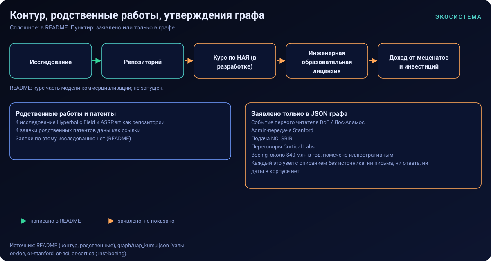

**[English](ECOSYSTEM.md) | Русский**

[← Исследование по реверс-инжинирингу НАЯ](../README.ru.md) · [Индекс руководства](README.ru.md)

# Экосистема ASRP, ИС и курс

## Образовательная программа и модель коммерциализации

Исследование ASRP по реверс-инжинирингу UAP сопровождается **образовательной программой** на платформе **Arcanum-12** ([`https://arcanum12th.education`](https://arcanum12th.education)). В разработке — выделенный **курс по реверс-инжинирингу UAP**, статус: в ожидании подтверждения страницы курса. Образовательная программа — **часть модели коммерциализации проекта**: исследование → репозиторий → курс → инженерная образовательная лицензия → бандлированные курсы по микроэлектронике и embedded-системам → продвинутые материалы по реверс-инжинирингу UAP. Доход от меценатства и инвестиций замыкает контур, поддерживая исследовательско-публикационный конвейер.

Сопутствующий репозиторий маркетинга экосистемы (`ASRP_ecosystem_marketing/`) документирует полную архитектуру коммерциализации ASRP, включая Arcanum-12, GFS, ASRP.media и субстрат рейтингов Kapusta. Этот репозиторий по UAP-исследованию вносит **трек исследований и публикаций** в эту архитектуру.

**Чего эта секция НЕ утверждает**

- **НЕ** утверждает, что курс по реверс-инжинирингу UAP в настоящее время доступен для записи студентов.
- **НЕ** утверждает, что credentials по завершению курса в настоящее время выпускаются.
- **НЕ** обещает конкретной даты запуска курса.
- **НЕ** утверждает, что прохождение курса даёт какую-либо специальную авторизацию.

Хаб нигде не называет репозиторий курса, и страницы курса по ссылке нет. Контур выше — заявленная модель, а не результат; утверждения графа об аутриче перечислены отдельно в разделе [Доказательства](EVIDENCE.ru.md#утверждения-только-из-графа).

## Связь с патентом

**Патентной заявки пока нет — исследование поисковое.** Исследование ASRP по реверс-инжинирингу UAP — открытая поисковая программа (мульти-конвейерный анализ артефакта, архивные корпусы, OSINT-методология, консолидация на публичных источниках) и **не** привязана ни к какой заявке в Казпатенте. Патенты, упомянутые в этом репозитории, фигурируют только как **исследовательские данные**, а не как интеллектуальная собственность данного исследования:

- **Трек 7** инвентаризирует **патенты 11 внешних изобретателей** как публично-источниковый аналитический корпус о созвездии prime-подрядчиков — это сторонние патенты, которые *изучаются*, а не заявки ASRP.
- Таблица **Патентного портфеля** ниже перечисляет патенты **родственных исследований ASRP** (Фрактальная биомедицинская система, ASRP.art, ASRP.drift, ГСП) как ссылки экосистемы — ни один из них не является ИС-базой данного UAP-исследования.

| Патент | Заявка | Ссылка |
|---|---|---|
| _Пока нет — поисковое исследование_ | — | — |

Файл графа описывает одну из родственных заявок (FBHFS) как якорь «UAP-смежной онкологической» рамки; README говорит, что патента у этого исследования нет, а единственный онкологический текст корпуса — спекуляция в выдержке из книги Черноброва ([Открытые вопросы](OPEN.ru.md)).

## Предварительная регистрация OSF

| Поле | Значение |
|---|---|
| **Статус** | Уточняется |
| **Платформа** | [OSF.io](https://osf.io) |

Ни одного ID регистрации в репозитории не записано.

## Связанные репозитории и родственные патенты

### Связанные исследовательские репозитории

| Репозиторий | Направление | Ссылка |
|---|---|---|
| **Исследование плазмы крови** (Hyperbolic Field Blood Plasma Study) | Свёртываемость плазмы | [Просмотр](https://github.com/AdvancedScientificResearchProjects/Hyperbolic_Field_BloodPlasma_Study) |
| **Сельскохозяйственное исследование** (Hyperbolic Field Agricultural Study) | Рост растений и семян | [Просмотр](https://github.com/AdvancedScientificResearchProjects/Hyperbolic_Field_Agricultural_Study) |
| **Исследование кристаллов DAAT** (Hyperbolic Field DAAT Crystal Study) | Взаимодействие кристалл-человек | [Просмотр](https://github.com/AdvancedScientificResearchProjects/Hyperbolic_Field_DAAT_Crystal_Study) |
| **Исследование дрожжей Saccharomyces** (Hyperbolic Field Saccharomyces Study) | Ферментация дрожжей | [Просмотр](https://github.com/AdvancedScientificResearchProjects/Hyperbolic_Field_SaccharomycesCerevisiae_Study) |
| **ASRP.art** | Искусство и сознание | [Просмотр](https://github.com/AdvancedScientificResearchProjects/Axionetic_Sensing_Reactions_Platform_in_Art) |

### Патентный портфель (родственные исследования, ссылки)

Колонка называется «Заявка»: это патентные заявки родственных исследований, а не выданные патенты, и они не входят в это исследование.

| Патент | Заявка | Ссылка |
|---|---|---|
| **Фрактальная биомедицинская система** | KZ 2025/1095.1 | [Просмотр](https://github.com/denisbanchenko/Kazpatent_Fractal_Biomedical_System_Patent) |
| **ПНИР.искусство** (ASRP.art) | KZ 2025/0592.1 + PCT | [Просмотр](https://github.com/denisbanchenko/Kazpatent_Axionetic_Sensing_Reactions_Platform_in_Art_Patent) |
| **ПНИР.дрифт** (ASRP.drift) | KZ 413554 | [Просмотр](https://github.com/denisbanchenko/Kazpatent_Advanced_Synchro_Resonance_Platform_For_Deep_Resonant_Patent) |
| **ГСП** (GFS) | KZ 2025/1096.1 | [Просмотр](https://github.com/denisbanchenko/Kazpatent_Global_Forecasting_System_Patent) |

Номер, записанный для ASRP.drift («KZ 413554»), приведён так, как его дал прежний README; здесь он не сверялся с заявкой ([Открытые вопросы](OPEN.ru.md)).

## Поддержка

> **Если эта работа вам полезна — поддержите нас.** 7 уровней меценатства — от Главного Филантропа до Индивидуального Вкладчика.
>
> **Поддержать:** <https://asrp.tech/en/patrons>
> **Инвестиционные запросы:** _в ожидании — добавляется при предоставлении_

Поддержать: если эта работа вам полезна — https://asrp.tech/en/patrons
