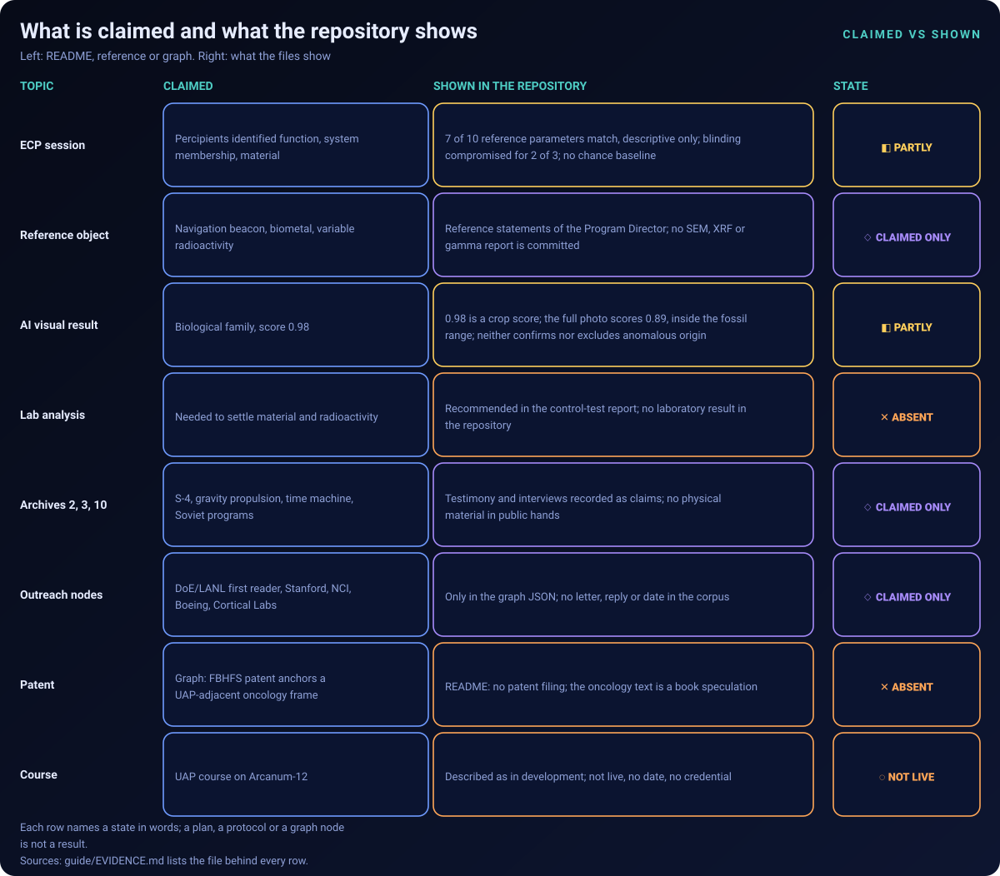

**English | [Русский](EVIDENCE.ru.md)**

[← UAP Reverse Engineering Study](../README.md) · [Guide index](README.md)

# Evidence: claimed versus shown

## Claimed versus shown

The one experiment in this study gives a **descriptive overlap**, not a validation: <!--n:ref_exact-->7<!--/n--> of <!--n:ref_params-->10<!--/n--> reference parameters match, <!--n:ref_partial-->2<!--/n--> partly and <!--n:ref_miss-->1<!--/n--> not at all, while blinding was compromised for <!--n:blinded_compromised_n-->2<!--/n--> of <!--n:percipient_reports-->3<!--/n--> percipients and there is no chance baseline. The AI pipeline classifies the artifact photo as looking like a fossil: the headline 0.98 is a crop score, the full photo scores 0.89 and sits inside the range of real echinoid fossils. The ten other tracks record claims and public records; none of that is validated here. The repository's own words for the limit: the control test "neither confirms nor excludes anomalous origin"; the ECP is "a structured hypothesis-generation tool", not validation.

Every row below names the file it comes from (paths of the previous README point to the archived copy, `archive/README_2026-11-19_pre-showcase.md`, whose line numbers are the old ones).

## What the repository shows

| Statement | Source |
|---|---|
| The ECP session produced descriptive overlap counts only: <!--n:ref_exact-->7<!--/n--> exact, <!--n:ref_partial-->2<!--/n--> partial, <!--n:ref_miss-->1<!--/n--> miss of <!--n:ref_params-->10<!--/n--> reference parameters; the report itself denies independent convergence. | `analysis/ecp_validation_report.md:93` |
| Blinding was compromised for 2 of 3 percipients (the same group call); future sessions must be individual. | `analysis/ecp_validation_report.md:162` |
| In the AI control test the artifact is visually inside the range of echinoid fossils (n=5 similar fossils) and far above the negative controls. | `reports/ai_reports/AI-2026-04-09-control-test.md:141` |
| The control test itself says the visual classifier cannot tell a fossil from a non-biological look-alike; only laboratory analysis can. | `reports/ai_reports/AI-2026-04-09-control-test.md:157` |
| The control test neither confirms nor excludes anomalous origin. | `reports/ai_reports/AI-2026-04-09-control-test.md:241` |
| A <!--n:pipeline_stages-->10<!--/n-->-stage computer-vision pipeline exists as runnable code (Grounding DINO, SAM2, DINOv2, SigLIP2, EfficientAD, CLIP, Depth-Anything) and its stage outputs are committed in data/processed. | `pipeline/run.py:45` |
| OSINT method applied to the Lazar narratives: only Element 115 passes, and as standard physics (the JINR+LLNL synthesis is a published external result). | `osint-intelligence-analysis/analysis/uap-application.md:21` |
| The origin taxonomy is explicitly a vocabulary, not a research finding. | `analysis/uap-taxonomy.md:130` |
| Chernobrov's Russian patent application was discontinued and never granted (an external fact recorded in the archive). | `chernobrov-archive/README.md:209` |
| Track 6 records public sources only and does not attribute any of the eleven cases to UAP-related activity. | `people-analysis/README.md:177` |
| Track 7 does not assert that any named company performed UAP reverse engineering. | `corporate-economic-analysis/README.md:177` |

## Claimed, not proven

| Statement | Source |
|---|---|
| The artifact's function (navigation beacon, triangulation system) rests only on the Program Director's disclosed reference; no independent measurement or document is in the repository. | `analysis/ecp_validation_report.md:53` |
| 'Biometal' and 'variable radioactivity' are reference statements only; no SEM, XRF or gamma report is committed. | `analysis/ecp_validation_report.md:58` |
| The key AI findings table gives the biological-family confidence as 0.98; that is the score of the cropped image, while the control test scores the full photo 0.89, inside the fossil range. | `archive/README_2026-11-19_pre-showcase.md:221` |
| Placing the artifact in the 'temporal' origin category rests on a single phrase from the Program Director and is a working hypothesis. | `analysis/uap-taxonomy.md:116` |
| The previous README's hypothesis table labels the signal/navigation function 'Supported' although blinding was compromised for 2 of 3. | `archive/README_2026-11-19_pre-showcase.md:181` |
| The 'temporal navigation' hypothesis has weak indirect support from one percipient's wording only. | `archive/README_2026-11-19_pre-showcase.md:186` |
| ECP is described as a hypothesis-generation tool, not validation. | `analysis/ecp_validation_report.md:180` |
| Lazar's S-4 and gravity-propulsion statements remain single-witness claims with no physical material in public hands. | `analysis/uap-taxonomy.md:46` |
| The fuel-supply-chain loop (Lazar, element 115, JINR/LLNL, Amentum) is a hypothesis-space mapping, not an institutional pipeline. | `archive/README_2026-11-19_pre-showcase.md:329` |
| The Kazakhstan geology and UAP link is a conjecture that must become falsifiable before it is a claim. | `dubna-element-115-analysis/analysis/kazakhstan-uap-geological.md:3` |
| Chernobrov's time shift of about -3 percent over 30 minutes is an archive-recorded claim, not a verified measurement. | `chernobrov-archive/README.md:207` |
| The PURSUE 'Stage-9 QA' certifying 100 percent record coverage is the repository's own self-assessment. | `archive/README_2026-11-19_pre-showcase.md:378` |
| Four outreach nodes appear only in graph/uap_kumu.json: a DoE / Los Alamos 'first-reader event', Stanford, NCI SBIR and Cortical Labs; no letter, reply or date exists in the corpus. | `graph/uap_kumu.json:361` |
| The graph says the FBHFS patent anchors a 'UAP-adjacent oncology' frame, while the README says no patent underlies this study. | `graph/uap_kumu.json:202` |
| The research, course, license, patron-income loop is a stated model; the course is not live. | `archive/README_2026-11-19_pre-showcase.md:390` |

## Not yet done

| Statement | Source |
|---|---|
| Only one ECP session exists (3 percipients); no repeat or individually blinded session is recorded. | `archive/README_2026-11-19_pre-showcase.md:148` |
| Laboratory analysis (SEM-EDS, XRF, gamma spectroscopy over time) is recommended and not done. | `reports/ai_reports/AI-2026-04-09-control-test.md:225` |
| A chance baseline for the response overlap is not computed; the protocol carries only a TP/FP template. | `experiments/protocol_ecp.md:154` |
| OSF preregistration: status 'To be determined', no ID. | `archive/README_2026-11-19_pre-showcase.md:547` |
| No patent filing exists for this study. | `archive/README_2026-11-19_pre-showcase.md:554` |
| The UAP course on Arcanum-12 is in development, pending a course page: not live, no date, no credentials. | `archive/README_2026-11-19_pre-showcase.md:390` |
| The source photograph data/raw/UAP-FRAG-001.jpg required by the pipeline is not in the repository (Issue #4). | `pipeline/README.md:32` |
| The investment-inquiry URL is still pending. | `archive/README_2026-11-19_pre-showcase.md:37` |

## Claims found only in the graph

The knowledge graph (`graph/uap_kumu.json`, <!--n:graph_nodes-->499<!--/n--> nodes, <!--n:graph_edges-->896<!--/n--> links, <!--n:graph_facts-->83<!--/n--> facts of which <!--n:graph_facts_high-->55<!--/n--> are rated high confidence) carries <!--n:graph_outreach-->4<!--/n--> nodes of type outreach and a few others that read like events or access. They have a description and no source field. They are **claimed in the graph; not shown** in the corpus: no letter, reply or date exists in the repository.

| What the graph says | Source |
|---|---|
| DoE / Los Alamos: 'first-reader event' on this repository after publication | `graph/uap_kumu.json:355` |
| Stanford / Nolan Lab: 'active outreach track', admin handoff in February 2026 | `graph/uap_kumu.json:367` |
| NCI SBIR FY26: submission, then programme-wide cancellation on 2025-10-01 | `graph/uap_kumu.json:379` |
| Cortical Labs: 'active negotiations (2026-Q2)' | `graph/uap_kumu.json:391` |
| Boeing: a DARPA BAA reverse-engineering line of about $40M a year, labelled illustrative | `graph/uap_kumu.json:295` |
| 'ASRP holds DARPA BAA proposal-portal access' | `graph/uap_kumu.json:343` |

Shown as claimed, not as shown: the names of institutions and programmes in this table are what the graph says, not what the repository documents. Outreach, access and funding statements are not carried to the front page as facts.

## Limits of the evidence

- **Blinding.** One group call, sequential questioning; the first percipient had also seen the object earlier. The responses of the last two cannot be independent observations.
- **Scoring.** The ten reference parameters were scored after the reference was disclosed; the cross comparison has a different 14-theme table with HIGH, MEDIUM and LOW levels; no chance baseline exists.
- **Sample.** Three percipients, one session, one object.
- **Reference.** "Biometal" and "variable radioactivity" are statements of the Program Director; the AI result (a dark echinoid-like object) is not reconciled with them.
- **Controls.** Five similar fossils from mixed sources; no identical-condition photograph; one model; RGB only.
- **Archives.** Testimony and interviews are recorded as said; the track READMEs state that claims are not imported between archives.
