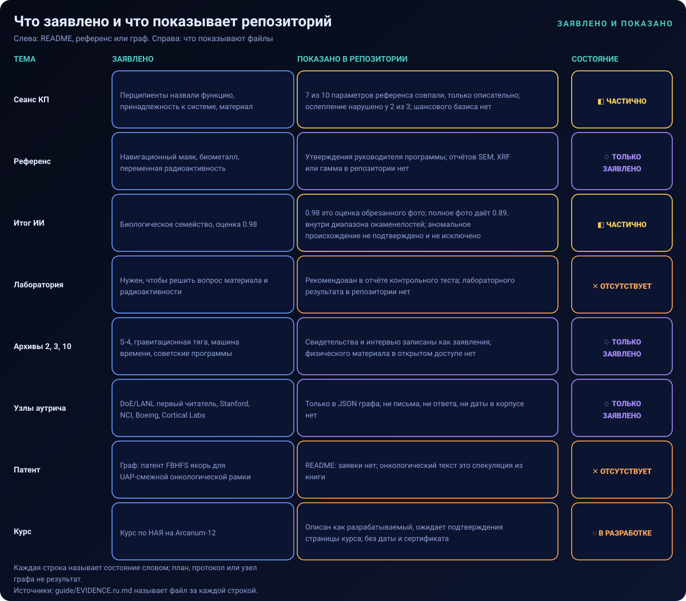

**[English](EVIDENCE.md) | Русский**

[← Исследование по реверс-инжинирингу НАЯ](../README.ru.md) · [Индекс руководства](README.ru.md)

# Доказательства: заявлено и показано

## Заявлено и показано

Единственный эксперимент этого исследования даёт **описательное пересечение**, а не валидацию: <!--n:ref_exact-->7<!--/n--> из <!--n:ref_params-->10<!--/n--> параметров референса совпали, <!--n:ref_partial-->2<!--/n--> частично и <!--n:ref_miss-->1<!--/n--> не совпал, при этом ослепление нарушено у <!--n:blinded_compromised_n-->2<!--/n--> из <!--n:percipient_reports-->3<!--/n--> перципиентов, а шансового базиса нет. ИИ-конвейер классифицирует фото артефакта как похожее на окаменелость: заглавное 0.98 — оценка обрезки, полное фото даёт 0.89 и лежит внутри диапазона настоящих окаменелостей эхиноидов. Остальные десять треков фиксируют заявления и публичные записи; ничто из этого здесь не валидируется. Слова самого репозитория о границе: контрольный тест «не подтверждает и не исключает аномальное происхождение»; КП — «структурированный инструмент генерации гипотез», а не валидация.

Каждая строка ниже называет файл, откуда она взята (пути прежнего README указывают на архивную копию `archive/README_2026-11-19_pre-showcase.md`, номера строк в ней прежние).

## Что показывает репозиторий

| Утверждение | Источник |
|---|---|
| Сеанс КП дал только описательные счётчики пересечения: <!--n:ref_exact-->7<!--/n--> точных, <!--n:ref_partial-->2<!--/n--> частичных, <!--n:ref_miss-->1<!--/n--> промах из <!--n:ref_params-->10<!--/n--> параметров референса; отчёт сам отрицает независимую конвергенцию. | `analysis/ecp_validation_report.md:93` |
| Ослепление нарушено у 2 из 3 перципиентов (один групповой звонок); будущие сеансы должны быть индивидуальными. | `analysis/ecp_validation_report.md:162` |
| В контрольном тесте ИИ артефакт визуально внутри диапазона окаменелостей эхиноидов (n=5 похожих) и намного выше негативных контролей. | `reports/ai_reports/AI-2026-04-09-control-test.md:141` |
| Сам контрольный тест говорит, что визуальный классификатор не отличает окаменелость от небиологического двойника; это может лишь лабораторный анализ. | `reports/ai_reports/AI-2026-04-09-control-test.md:157` |
| Контрольный тест не подтверждает и не исключает аномальное происхождение. | `reports/ai_reports/AI-2026-04-09-control-test.md:241` |
| Конвейер компьютерного зрения из <!--n:pipeline_stages-->10<!--/n--> стадий существует как запускаемый код (Grounding DINO, SAM2, DINOv2, SigLIP2, EfficientAD, CLIP, Depth-Anything), выходы стадий закоммичены в data/processed. | `pipeline/run.py:45` |
| Метод OSINT, применённый к нарративам Лазара: проходит только Элемент 115, и как стандартная физика (синтез ОИЯИ+LLNL — опубликованный внешний результат). | `osint-intelligence-analysis/analysis/uap-application.md:21` |
| Таксономия происхождения прямо названа словарём, а не результатом исследования. | `analysis/uap-taxonomy.md:130` |
| Российская патентная заявка Черноброва прекращена и не была выдана (внешний факт, записанный в архиве). | `chernobrov-archive/README.md:209` |
| Трек 6 фиксирует только публичные источники и не относит ни один из одиннадцати случаев к UAP-деятельности. | `people-analysis/README.md:177` |
| Трек 7 не утверждает, что какая-либо названная компания занималась реверс-инжинирингом НАЯ. | `corporate-economic-analysis/README.md:177` |

## Заявлено, но не доказано

| Утверждение | Источник |
|---|---|
| Функция артефакта (навигационный маяк, триангуляционная система) опирается только на раскрытый референс руководителя программы; независимого измерения или документа в репозитории нет. | `analysis/ecp_validation_report.md:53` |
| «Биометалл» и «переменная радиоактивность» — только референсные утверждения; отчётов SEM, XRF или гамма в репозитории нет. | `analysis/ecp_validation_report.md:58` |
| Таблица ключевых результатов ИИ даёт уверенность биологического семейства 0.98; это оценка обрезанного изображения, а контрольный тест оценивает полное фото в 0.89, внутри диапазона окаменелостей. | `archive/README_2026-11-19_pre-showcase.md:221` |
| Помещение артефакта в «темпоральную» категорию происхождения опирается на одну фразу руководителя программы и является рабочей гипотезой. | `analysis/uap-taxonomy.md:116` |
| Таблица гипотез прежнего README помечает сигнальную/навигационную функцию «Поддержано», хотя ослепление нарушено у 2 из 3. | `archive/README_2026-11-19_pre-showcase.md:181` |
| Гипотеза «темпоральной навигации» имеет слабую косвенную поддержку только из формулировки одного перципиента. | `archive/README_2026-11-19_pre-showcase.md:186` |
| КП описан как инструмент генерации гипотез, а не валидации. | `analysis/ecp_validation_report.md:180` |
| Утверждения Лазара о S-4 и гравитационной силовой установке остаются заявлениями одного свидетеля без физического материала в открытом доступе. | `analysis/uap-taxonomy.md:46` |
| Контур цепочки топливоснабжения (Лазар, элемент 115, ОИЯИ/LLNL, Amentum) — отображение пространства гипотез, а не институциональный конвейер. | `archive/README_2026-11-19_pre-showcase.md:329` |
| Связь геологии Казахстана и НАЯ — предположение, которое должно стать опровержимым, прежде чем станет утверждением. | `dubna-element-115-analysis/analysis/kazakhstan-uap-geological.md:3` |
| Сдвиг времени Черноброва около -3 процентов за 30 минут — записанное в архиве заявление, а не проверенное измерение. | `chernobrov-archive/README.md:207` |
| «QA Этапа 9» PURSUE, подтверждающее 100% покрытия записей, — собственная оценка репозитория. | `archive/README_2026-11-19_pre-showcase.md:378` |
| Четыре узла аутрича есть только в graph/uap_kumu.json: «событие первого читателя» DoE / Лос-Аламос, Stanford, NCI SBIR и Cortical Labs; ни письма, ни ответа, ни даты в корпусе нет. | `graph/uap_kumu.json:361` |
| Граф говорит, что патент FBHFS — якорь «UAP-смежной онкологической» рамки, тогда как README говорит, что патента у этого исследования нет. | `graph/uap_kumu.json:202` |
| Контур исследование, курс, лицензия, доход меценатов — заявленная модель; репозиторий не утверждает, что курс запущен (указано: в разработке, ожидает подтверждения страницы курса). | `archive/README_2026-11-19_pre-showcase.md:390` |

## Ещё не сделано

| Утверждение | Источник |
|---|---|
| Есть только один сеанс КП (3 перципиента); повторного или индивидуально ослеплённого сеанса не записано. | `archive/README_2026-11-19_pre-showcase.md:148` |
| Лабораторный анализ (SEM-EDS, XRF, гамма-спектроскопия во времени) рекомендован и не выполнен. | `reports/ai_reports/AI-2026-04-09-control-test.md:225` |
| Шансовый базис для пересечения ответов не посчитан; в протоколе есть лишь шаблон TP/FP. | `experiments/protocol_ecp.md:154` |
| Предрегистрация OSF: статус «Уточняется», ID нет. | `archive/README_2026-11-19_pre-showcase.md:547` |
| Заявки на патент по этому исследованию нет. | `archive/README_2026-11-19_pre-showcase.md:554` |
| Курс по НАЯ на Arcanum-12 разрабатывается, ждёт страницы курса: репозиторий не утверждает, что он запущен; без даты и сертификатов. | `archive/README_2026-11-19_pre-showcase.md:390` |
| Исходной фотографии data/raw/UAP-FRAG-001.jpg, нужной конвейеру, в репозитории нет (Issue #4). | `pipeline/README.md:32` |
| URL для инвестиционных запросов всё ещё не указан. | `archive/README_2026-11-19_pre-showcase.md:37` |

## Утверждения только из графа

Граф знаний (`graph/uap_kumu.json`, <!--n:graph_nodes_ru-->499 узлов<!--/n-->, <!--n:graph_edges_ru-->896 связей<!--/n-->, <!--n:graph_facts-->83<!--/n--> фактов, из них <!--n:graph_facts_high-->55<!--/n--> с высокой уверенностью) содержит <!--n:graph_outreach-->4<!--/n--> узла типа outreach и несколько других, читающихся как события или доступ. У них есть описание и нет поля источника. Они **заявлены в графе; не показаны** в корпусе: ни письма, ни ответа, ни даты в репозитории нет.

| Что говорит граф | Источник |
|---|---|
| DoE / Лос-Аламос: «событие первого читателя» этого репозитория после публикации | `graph/uap_kumu.json:355` |
| Stanford / Nolan Lab: «активный аутрич-трек», admin-передача в феврале 2026 | `graph/uap_kumu.json:367` |
| NCI SBIR FY26: подача, затем общесистемная отмена программы 2025-10-01 | `graph/uap_kumu.json:379` |
| Cortical Labs: «активные переговоры (Q2 2026)» | `graph/uap_kumu.json:391` |
| Boeing: линия DARPA BAA по реверс-инжинирингу около $40 млн в год, помечена иллюстративной | `graph/uap_kumu.json:295` |
| «ASRP имеет доступ к порталу заявок DARPA BAA» | `graph/uap_kumu.json:343` |

Показано как заявленное, а не как показанное: названия организаций и программ в этой таблице — то, что говорит граф, а не то, что документирует репозиторий. Утверждения об аутриче, доступе и финансировании на титульную страницу как факты не переносятся.

## Границы доказательств

- **Ослепление.** Один групповой звонок, последовательный опрос; первый перципиент к тому же раньше видел объект. Ответы двух последних не могут быть независимыми наблюдениями.
- **Оценка.** Десять параметров референса оценены после раскрытия референса; в сравнении ответов другая таблица из 14 тем с уровнями HIGH, MEDIUM и LOW; шансового базиса нет.
- **Выборка.** Три перципиента, один сеанс, один объект.
- **Референс.** «Биометалл» и «переменная радиоактивность» — утверждения руководителя программы; результат ИИ (тёмный объект, похожий на эхиноид) с ними не согласован.
- **Контроли.** Пять похожих окаменелостей из разных источников; нет фото в идентичных условиях; один метод; только RGB.
- **Архивы.** Свидетельства и интервью записаны как сказанные; README треков говорят, что заявления между архивами не импортируются.
