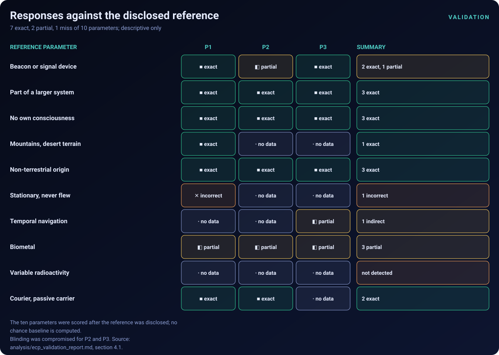
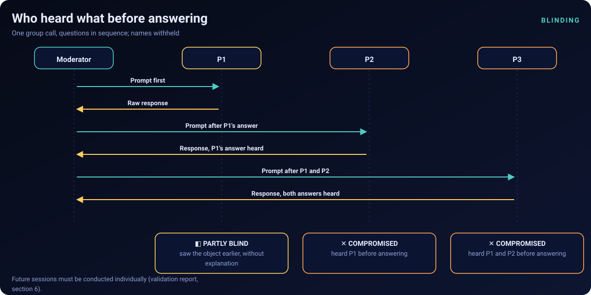
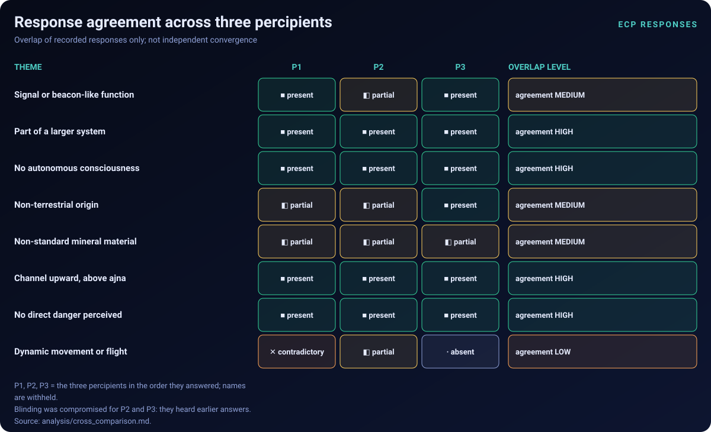
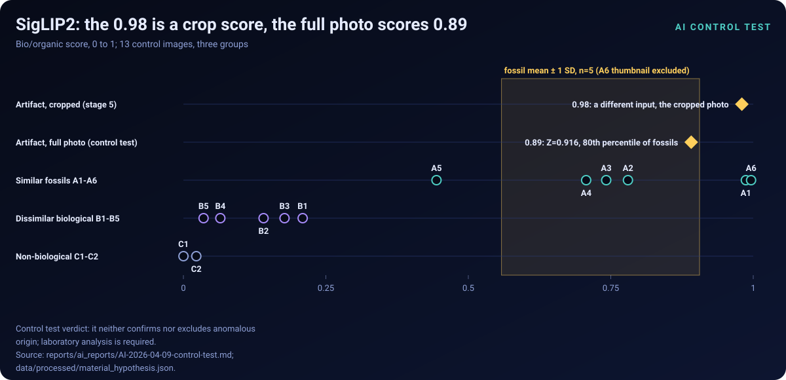
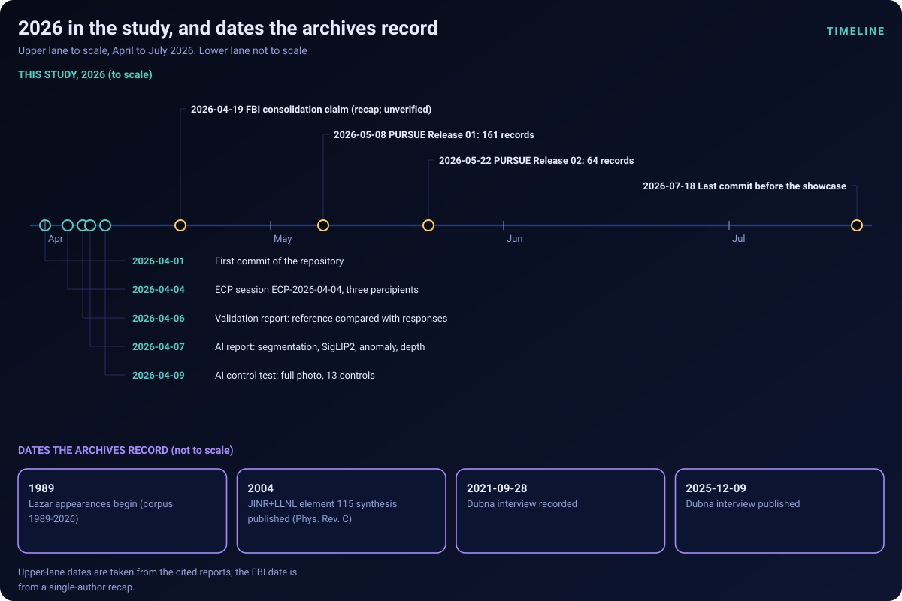
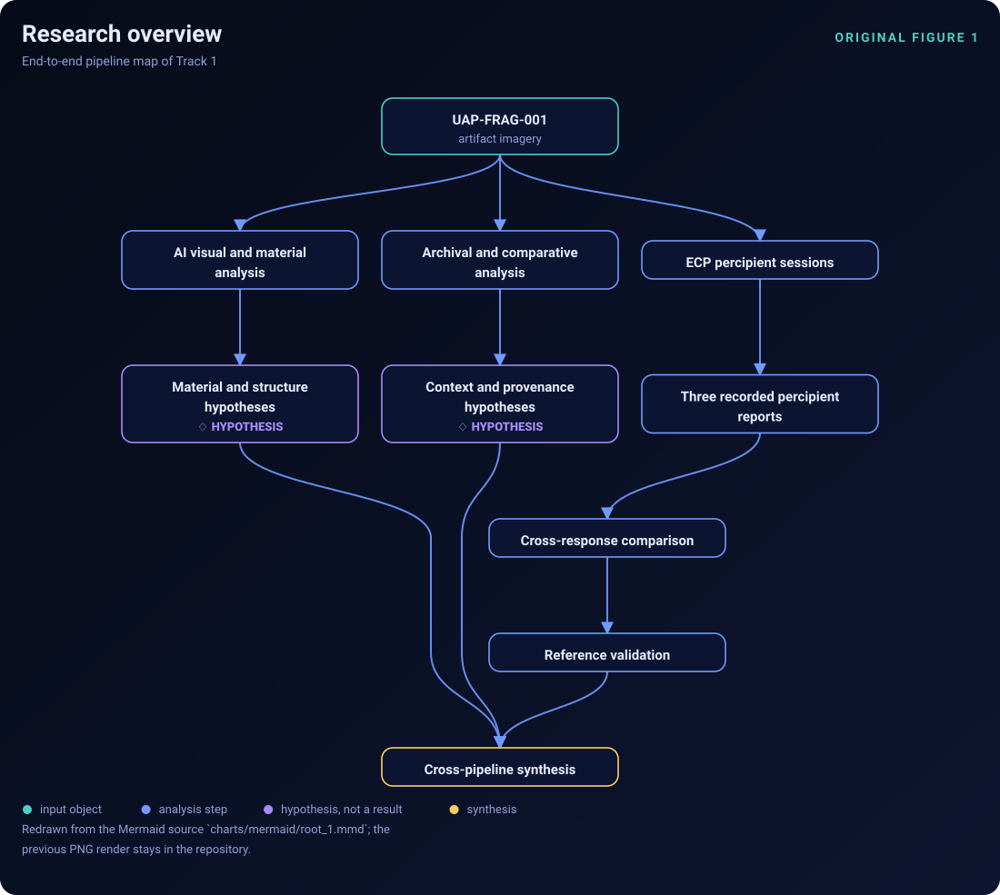
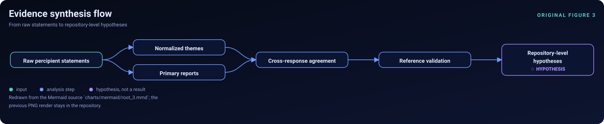
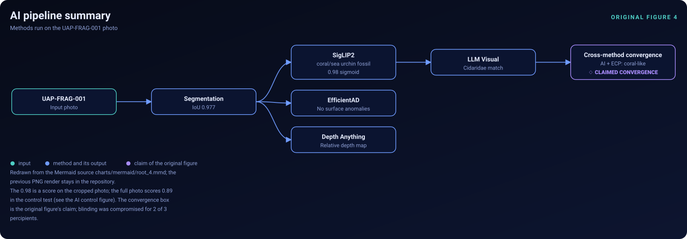
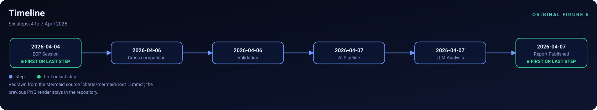

**English | [Русский](EXPERIMENT.ru.md)**

[← UAP Reverse Engineering Study](../README.md) · [Guide index](README.md)

# Track 1: the artifact experiment

## Track 1 at a glance

One object (`UAP-FRAG-001`), one percipient session, a <!--n:pipeline_stages-->10<!--/n-->-stage computer-vision pipeline and a control test. The numbers below are the previous README's table; the right-hand column says what kind of number each is.

| Parameter | Value | Status |
|---|---|---|
| **Artifact ID** | `UAP-FRAG-001` | Active case |
| **Primary ECP session** | `ECP-2026-04-04` | Completed |
| **Recorded percipient reports** | 3 | Available |
| **Verifiable reference parameters** | 10 | Validated (the Russian text says "compared") |
| **Exact matches** | 7/10 | Descriptive |
| **Partial or indirect matches** | 2/10 | Descriptive |
| **Complete misses** | 1/10 | Descriptive |
| **Repeated themes across all 3 responses** | 4 | Descriptive |
| **Known methodological limitation** | Compromised blinding for 2 later percipients | Critical |
| **Protocol version** | 2.0 | Synchronized |

**Key metrics.**

| Metric | Value | Interpretation |
|---|---|---|
| **Percipient count** | 3 | Small exploratory session |
| **All-response repeated themes** | 4 | Beacon-like function, larger system, no consciousness, non-terrestrial origin |
| **Exact-or-partial coverage** | 9/10 | Broad descriptive overlap with disclosed reference |
| **Direct contradiction count** | 1 | Flight vs stationary placement |
| **Undetected reference property** | 1 | Variable radioactivity |
| **Later percipients with compromised blinding** | 2/3 | Limits independent interpretation |

The current Track 1 material is strongest where it separates raw percipient records, descriptive overlap analysis, and later validation against disclosed reference data.

The study's own validation report states the limit in one sentence: "These counts are descriptive only and do not establish independent convergence because blinding was compromised for two percipients." No chance baseline is computed; the ECP protocol carries only an empty true-positive / false-positive template (`experiments/protocol_ecp.md`).

## The session and its blinding

In session `ECP-2026-04-04` three percipients assessed the unidentified artifact `UAP-FRAG-001` under the ASRP ECP Protocol v2.0. After all assessments were collected, the Program Director disclosed reference data about the object, and the report compares the answers with it. The moderator is the Chief AI Engineer; the reference source is the Program Director.

The percipients are P1, P2 and P3 in the order they answered; names are withheld here. The first one had seen the object earlier without explanation (partial blinding); the other two answered after hearing earlier responses in the same group call. The report concludes that later responses cannot be read as independent observations and that future sessions must be conducted individually, with control objects, exact timing and a recorded pre-session state.

Only this one session exists in the repository; no repeat or individually blinded session is recorded.

## Responses against the reference

The reference the Program Director disclosed after the session describes the object as a navigation beacon (an element of a triangulation navigation system for temporal navigation), part of a large stationary installation, made of a "biometal" with variable radioactivity, never flown. These are reference statements: no electron-microscope, XRF or gamma report is committed in the repository.

The two matrices of the previous README (`charts/ecp_response_agreement_matrix.svg` and `charts/ecp_reference_validation_matrix.svg`) name the percipients in their column heads, so they are redrawn here with P1 to P3; the originals stay in `charts/`.

**Working hypotheses.** The previous README labels each hypothesis; the last column says how to read it.

| Hypothesis | Status in the previous README | Basis | Reading here |
|---|---|---|---|
| **Artifact functions as a signal or navigation component** | Supported | Repeated in all 3 responses; exact or partial match to reference | Overlap only; blinding was compromised for 2 of 3, so "supported" is not independent support |
| **Artifact is part of a larger system** | Repeated in all responses | Exact match in all 3 responses | Repeated theme, descriptive |
| **Artifact is a non-autonomous tool** | Repeated in all responses | Exact match in all 3 responses | Repeated theme, descriptive |
| **Artifact origin is non-terrestrial** | Repeated theme | Present in all 3 responses, but with divergent details | Details diverge; no independent evidence |
| **Material is non-standard and mineral-like** | Partial support | Broad overlap only; precise "biometal" identification absent | Partial; the AI result points to a fossil-like look |
| **Artifact relates to temporal navigation** | Weak indirect support | Present only in one percipient's wording | One wording; the origin category rests on a single phrase |
| **Artifact has detectable radioactivity via ECP** | Not supported | No percipient detected it | Not supported |

The report calls ECP "a structured hypothesis-generation tool within the ASRP research framework, not standalone validation".

## AI and computer-vision results

A <!--n:pipeline_stages-->10<!--/n-->-stage pipeline (`pipeline/`) runs on one photograph of the artifact: preprocessing, detection (Grounding DINO), segmentation (SAM2), features (DINOv2), material families (SigLIP2), two anomaly detectors (EfficientAD, CLIP) and depth (Depth-Anything), then a report stage. Its stage outputs (<!--n:pipeline_outputs-->11<!--/n--> JSON files) are committed in `data/processed/`. The original source photograph `data/raw/UAP-FRAG-001.jpg` is not in the repository (Issue #4); a copy sits in `data/raw/control-images/`.

**Key AI findings.**

| Finding | Confidence | Method | Report |
|---|---|---|---|
| Biological/coral material family | 0.98 sigmoid (cropped image) | SigLIP2 | [AI-2026-04-07-001](../reports/ai_reports/AI-2026-04-07-001.md) |
| Sea urchin fossil (Cidaridae) visual match | High | LLM visual | [AI-2026-04-07-001-llm](../reports/ai_reports/AI-2026-04-07-001-llm-visual.md) |
| No surface anomalies detected | Expected | EfficientAD + CLIP | [AI-2026-04-07-001](../reports/ai_reports/AI-2026-04-07-001.md) |
| Converges with ECP data ("coral-like") | Cross-method | AI + ECP | [Cross-comparison](../analysis/cross_comparison.md) |

> **Limitation:** RGB analysis cannot determine chemical composition, alloy type, or radioactivity. See [AI Protocol v3.1](../experiments/protocol_ai.md#limitations--ограничения).

**The 0.98 is a crop score; the full photograph scores 0.89.** The 0.98 belongs to the cropped artifact image at pipeline stage 5. The control test of 2026-04-09 (`reports/ai_reports/AI-2026-04-09-control-test.md`) re-scored the full photograph: <!--n:score_full4-->0.8912<!--/n-->. It compared the artifact with <!--n:control_images-->13<!--/n--> control images in three groups (similar echinoid fossils, dissimilar biological specimens, non-biological objects). Against the <!--n:control_n_similar-->5<!--/n--> similar fossils (mean <!--n:fossil_mean-->0.7320<!--/n-->, standard deviation <!--n:fossil_std-->0.1738<!--/n-->) the artifact has Z = <!--n:fossil_z-->0.916<!--/n-->, the <!--n:fossil_pct-->80<!--/n-->th percentile, so it is not statistically distinguishable from them; the nearest dark fossil scores <!--n:score_nearest_fossil-->0.9870<!--/n-->, above the artifact. It lies far above the negative controls (maximum <!--n:score_max_negative-->0.023<!--/n-->). The test lists five limitations (small sample, mixed image sources, no identical-condition controls, one model, RGB only) and ends: "The control test neither confirms nor excludes anomalous origin." Laboratory analysis (SEM-EDS, XRF, gamma spectroscopy) is recommended and not in the repository.

The previous README states the visual finding as "Biological/coral material family" with confidence 0.98 and says the AI result "converges" with the percipients' "coral-like"; given the blinding and the control test, read both as description of appearance, not as evidence of origin or composition.

## Timeline

## Original diagrams

The previous README drew four Mermaid diagrams for Track 1; each is redrawn below as an SVG, with a link to the original PNG.

**Research overview** (end-to-end pipeline map):

Original figure: [`charts/mermaid/root_1.png`](../charts/mermaid/root_1.png) (Mermaid: [`root_1.mmd`](../charts/mermaid/root_1.mmd))

**Evidence synthesis flow:**

Original figure: [`charts/mermaid/root_3.png`](../charts/mermaid/root_3.png) (Mermaid: [`root_3.mmd`](../charts/mermaid/root_3.mmd))

**AI pipeline summary:**

Original figure: [`charts/mermaid/root_4.png`](../charts/mermaid/root_4.png) (Mermaid: [`root_4.mmd`](../charts/mermaid/root_4.mmd))

**Timeline:**

Original figure: [`charts/mermaid/root_5.png`](../charts/mermaid/root_5.png) (Mermaid: [`root_5.mmd`](../charts/mermaid/root_5.mmd))

The fifth diagram of the previous README, the session blinding sequence (`charts/mermaid/retry_1.png`), names the percipients; it is redrawn above without names.

## Research pipelines

| Pipeline | Description | Status |
|---|---|---|
| **AI Analysis** | Computer vision, material estimation | Active |
| **Archival** | Database comparison, pattern matching | Active |
| **ECP** | Human perception protocols | Active |

"Active" is the previous README's word. Of the three, only the AI pipeline exists as code with committed outputs; the ECP side is one session.

## Where the Track 1 files are

| Piece | What it is |
|---|---|
| [Cross Comparison](../analysis/cross_comparison.md) | Detailed descriptive overlap analysis |
| [Validation Report](../analysis/ecp_validation_report.md) | Parameter-level check against the disclosed reference |
| [Percipient Reports](../reports/percipient_reports/) | Primary session records (<!--n:percipient_reports-->3<!--/n--> reports; contain participant names and personal impressions) |
| [AI Analysis Reports](../reports/ai_reports/) | AI visual and material analysis results (<!--n:ai_reports-->3<!--/n--> reports) |
| [AI Report: CV Pipeline](../reports/ai_reports/AI-2026-04-07-001.md) | Segmentation, SigLIP2, anomaly detection, depth |
| [AI Report: LLM Visual](../reports/ai_reports/AI-2026-04-07-001-llm-visual.md) | LLM-based visual identification |
| [AI Report: Control Test](../reports/ai_reports/AI-2026-04-09-control-test.md) | SigLIP2 control validation with 14 reference images |
| [ECP Protocol](../experiments/protocol_ecp.md) | Percipient session protocol v2.0 |
| [AI Protocol](../experiments/protocol_ai.md) | AI analysis pipeline protocol v3.1 |
