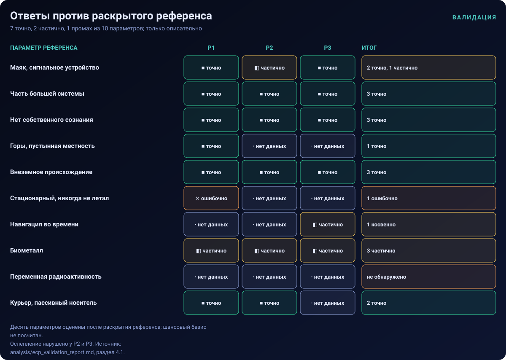
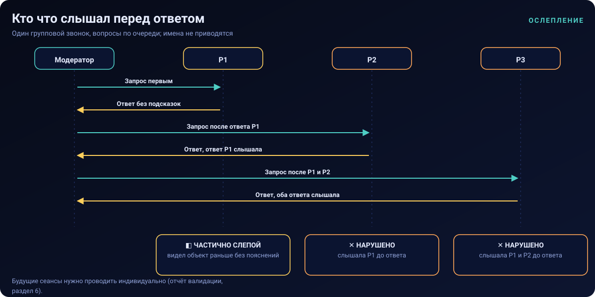
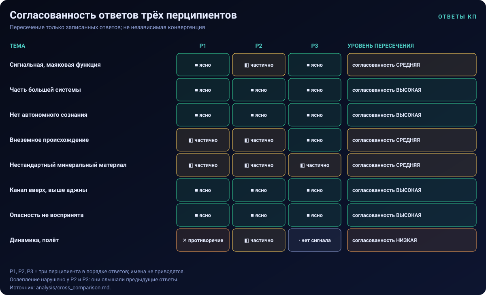
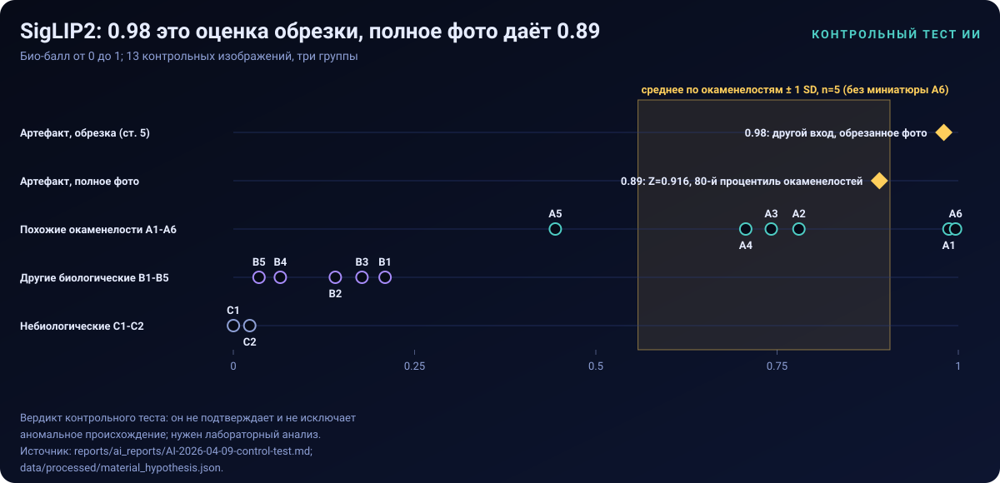
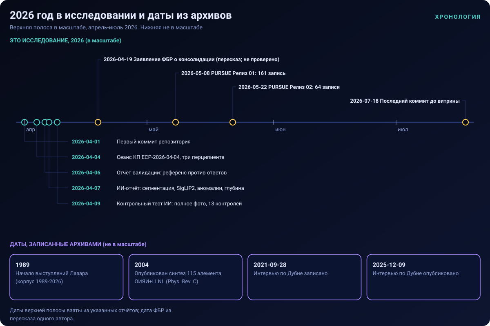
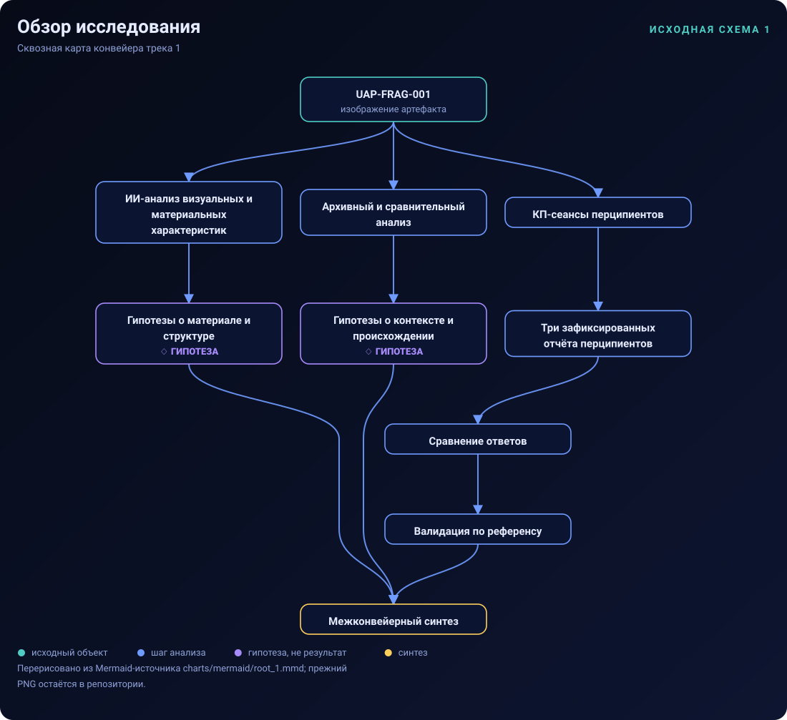
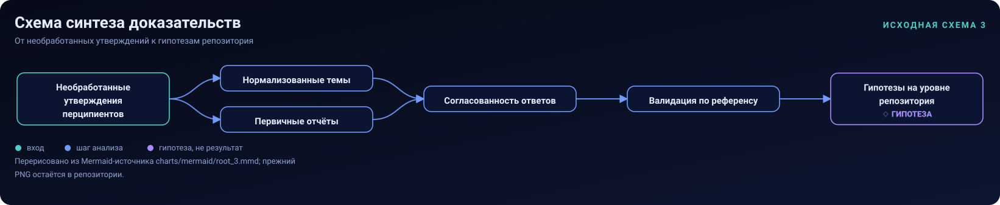
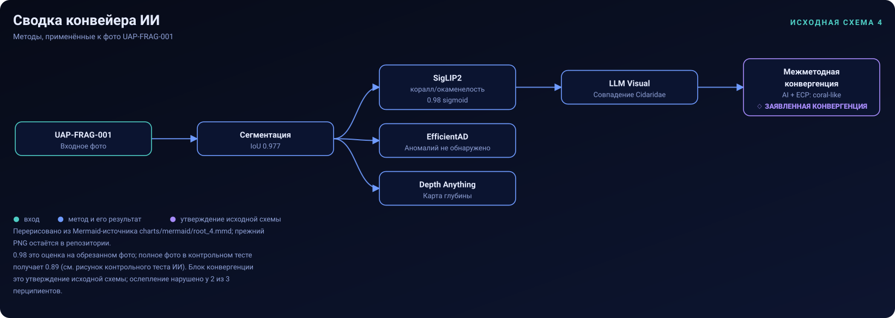
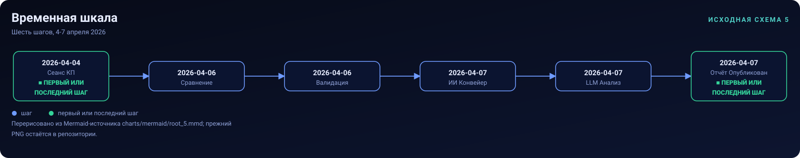

**[English](EXPERIMENT.md) | Русский**

[← Исследование по реверс-инжинирингу НАЯ](../README.ru.md) · [Индекс руководства](README.ru.md)

# Трек 1: исследование артефакта

## Трек 1 в цифрах

Один объект (`UAP-FRAG-001`), один сеанс перципиентов, конвейер компьютерного зрения из <!--n:pipeline_stages-->10<!--/n--> стадий и контрольный тест. Числа ниже взяты из таблицы прежнего README; правая колонка говорит, что это за число.

| Параметр | Значение | Статус |
|---|---|---|
| **ID артефакта** | `UAP-FRAG-001` | Активный кейс |
| **Основная КП-сессия** | `ECP-2026-04-04` | Завершено |
| **Зафиксированные отчёты перципиентов** | 3 | Доступны |
| **Проверяемые параметры референса** | 10 | Сопоставлены (английский текст прежнего README: «Validated») |
| **Точные совпадения** | 7/10 | Описательно |
| **Частичные или косвенные совпадения** | 2/10 | Описательно |
| **Полные промахи** | 1/10 | Описательно |
| **Повторяющиеся темы во всех 3 ответах** | 4 | Описательно |
| **Известное методологическое ограничение** | Нарушенное ослепление для 2 более поздних перципиентов | Критично |
| **Версия протокола** | 2.0 | Синхронизировано |

**Ключевые метрики.**

| Метрика | Значение | Интерпретация |
|---|---|---|
| **Число перципиентов** | 3 | Малый поисковый сеанс |
| **Темы, повторяющиеся во всех ответах** | 4 | Маяковая функция, часть большей системы, отсутствие сознания, внеземное происхождение |
| **Покрытие точными и частичными совпадениями** | 9/10 | Широкое описательное пересечение с раскрытым референсом |
| **Число прямых противоречий** | 1 | Полёт vs стационарное размещение |
| **Необнаруженное свойство референса** | 1 | Переменная радиоактивность |
| **Более поздние перципиенты с нарушенным ослеплением** | 2/3 | Ограничивает независимую интерпретацию |

Сила материала Трека 1 в том, что он разделяет первичные записи перципиентов, описательный анализ пересечений и последующую валидацию по раскрытым референсным данным.

Отчёт валидации самого исследования формулирует границу одной фразой: «Эти показатели носят описательный характер и не доказывают независимую конвергенцию, поскольку ослепление было нарушено для двух перципиентов». Шансовый базис не посчитан; в протоколе КП есть лишь пустой шаблон «верно-положительно / ложно-положительно» (`experiments/protocol_ecp.md`).

## Сеанс и его ослепление

В сеансе `ECP-2026-04-04` три перципиента оценили неопознанный артефакт `UAP-FRAG-001` по протоколу ASRP ECP v2.0. После сбора всех оценок руководитель программы раскрыл референсные данные об объекте, и отчёт сравнивает с ними ответы. Модератор — главный ИИ-инженер; источник референса — руководитель программы.

Перципиенты обозначены P1, P2 и P3 в порядке ответов; имена здесь не приводятся. Первый видел объект раньше без пояснений (частичное ослепление); двое других отвечали, услышав предыдущие ответы в том же групповом звонке. Отчёт заключает, что поздние ответы нельзя трактовать как независимые наблюдения, а будущие сеансы нужно проводить индивидуально, с контрольными объектами, точной фиксацией времени и состояния перед сеансом.

В репозитории есть только этот один сеанс; повторного или индивидуально ослеплённого сеанса не записано.

## Ответы против референса

Референс, который руководитель программы раскрыл после сеанса, описывает объект как навигационный маяк (элемент триангуляционной навигационной системы для навигации во времени), часть крупной стационарной установки, из «биометалла» с переменной радиоактивностью, никогда не летавший. Это референсные утверждения: отчётов электронной микроскопии, XRF или гамма-спектрометрии в репозитории нет.

Две матрицы прежнего README (`charts/ecp_response_agreement_matrix.svg` и `charts/ecp_reference_validation_matrix.svg`) называют перципиентов в шапках колонок, поэтому здесь они перерисованы с P1-P3; оригиналы остаются в `charts/`.

**Рабочие гипотезы.** Прежний README присваивает каждой гипотезе метку; последняя колонка говорит, как её читать.

| Гипотеза | Статус в прежнем README | Основание | Как читать здесь |
|---|---|---|---|
| **Артефакт выполняет сигнальную или навигационную функцию** | Поддержано | Повторяется во всех 3 ответах; точное или частичное совпадение с референсом | Только пересечение; ослепление нарушено у 2 из 3, поэтому «поддержано» не независимая поддержка |
| **Артефакт является частью более крупной системы** | Повторяется во всех ответах | Точное совпадение во всех 3 ответах | Повторяющаяся тема, описательно |
| **Артефакт является неавтономным инструментом** | Повторяется во всех ответах | Точное совпадение во всех 3 ответах | Повторяющаяся тема, описательно |
| **Происхождение артефакта внеземное** | Повторяющаяся тема | Присутствует во всех 3 ответах, но с расходящимися деталями | Детали расходятся; независимых доказательств нет |
| **Материал нестандартный и минеральноподобный** | Частичная поддержка | Только широкое пересечение; точная идентификация «биометалла» отсутствует | Частично; результат ИИ указывает на облик окаменелости |
| **Артефакт связан с темпоральной навигацией** | Слабая косвенная поддержка | Присутствует только в формулировке одного перципиента | Одна формулировка; категория происхождения опирается на одну фразу |
| **Артефакт имеет обнаруживаемую через КП радиоактивность** | Не поддержано | Ни один перципиент не обнаружил | Не поддержано |

Отчёт называет КП «структурированным инструментом генерации гипотез в рамках исследовательской программы ASRP, а не самостоятельной валидацией».

## Результаты ИИ и компьютерного зрения

Конвейер из <!--n:pipeline_stages-->10<!--/n--> стадий (`pipeline/`) работает по одной фотографии артефакта: предобработка, детекция (Grounding DINO), сегментация (SAM2), признаки (DINOv2), семейства материалов (SigLIP2), два детектора аномалий (EfficientAD, CLIP) и глубина (Depth-Anything), затем стадия отчёта. Выходы стадий (<!--n:pipeline_outputs-->11<!--/n--> JSON-файлов) закоммичены в `data/processed/`. Исходной фотографии `data/raw/UAP-FRAG-001.jpg` в репозитории нет (Issue #4); копия лежит в `data/raw/control-images/`.

**Ключевые результаты ИИ.**

| Находка | Уверенность | Метод | Отчёт |
|---|---|---|---|
| Биологический/коралловый тип | 0.98 sigmoid (обрезанное изображение) | SigLIP2 | [AI-2026-04-07-001](../reports/ai_reports/AI-2026-04-07-001.md) |
| Визуальное совпадение Cidaridae (окаменелость морского ежа) | Высокая | LLM visual | [AI-2026-04-07-001-llm](../reports/ai_reports/AI-2026-04-07-001-llm-visual.md) |
| Поверхностные аномалии не обнаружены | Ожидаемо | EfficientAD + CLIP | [AI-2026-04-07-001](../reports/ai_reports/AI-2026-04-07-001.md) |
| Совпадает с КП («коралловое») | Межметодное | AI + ECP | [Сравнение ответов](../analysis/cross_comparison.md) |

> **Ограничение:** RGB-анализ не может определить химсостав, тип сплава или радиоактивность. См. [Протокол ИИ v3.1](../experiments/protocol_ai.md#limitations--ограничения).

**0.98 — оценка обрезки; полное фото даёт 0.89.** Значение 0.98 относится к обрезанному изображению артефакта на стадии 5 конвейера. Контрольный тест от 2026-04-09 (`reports/ai_reports/AI-2026-04-09-control-test.md`) заново оценил полную фотографию: <!--n:score_full4-->0.8912<!--/n-->. Он сравнил артефакт с <!--n:control_images-->13<!--/n--> контрольными изображениями в трёх группах (похожие окаменелости эхиноидов, непохожие биологические образцы, небиологические объекты). На фоне <!--n:control_n_similar-->5<!--/n--> похожих окаменелостей (среднее <!--n:fossil_mean-->0.7320<!--/n-->, стандартное отклонение <!--n:fossil_std-->0.1738<!--/n-->) у артефакта Z = <!--n:fossil_z-->0.916<!--/n-->, <!--n:fossil_pct-->80<!--/n-->-й процентиль: статистически он от них неотличим; ближайшая тёмная окаменелость даёт <!--n:score_nearest_fossil-->0.9870<!--/n-->, выше артефакта. Он намного выше негативных контролей (максимум <!--n:score_max_negative-->0.023<!--/n-->). Тест перечисляет пять ограничений (малая выборка, разные источники изображений, нет контролей в идентичных условиях, один метод, только RGB) и заканчивается: «Контрольный тест не подтверждает и не исключает аномальное происхождение». Лабораторный анализ (SEM-EDS, XRF, гамма-спектроскопия) рекомендован и в репозитории отсутствует.

Прежний README подаёт визуальный результат как «Биологический/коралловый тип» с уверенностью 0.98 и говорит, что результат ИИ «совпадает» с «коралловым» у перципиентов; с учётом ослепления и контрольного теста оба нужно читать как описание облика, а не как доказательство происхождения или состава.

## Временная шкала

## Исходные диаграммы

Прежний README рисовал для Трека 1 четыре диаграммы Mermaid; каждая перерисована ниже в SVG со ссылкой на исходный PNG.

**Обзор исследования** (сквозная схема конвейеров):

Исходная схема: [`charts/mermaid/root_1.png`](../charts/mermaid/root_1.png) (Mermaid: [`root_1.mmd`](../charts/mermaid/root_1.mmd))

**Схема синтеза доказательств:**

Исходная схема: [`charts/mermaid/root_3.png`](../charts/mermaid/root_3.png) (Mermaid: [`root_3.mmd`](../charts/mermaid/root_3.mmd))

**Сводка конвейера ИИ:**

Исходная схема: [`charts/mermaid/root_4.png`](../charts/mermaid/root_4.png) (Mermaid: [`root_4.mmd`](../charts/mermaid/root_4.mmd))

**Временная шкала:**

Исходная схема: [`charts/mermaid/root_5.png`](../charts/mermaid/root_5.png) (Mermaid: [`root_5.mmd`](../charts/mermaid/root_5.mmd))

Пятая диаграмма прежнего README, схема ослепления сеанса (`charts/mermaid/retry_1.png`), называет перципиентов; выше она перерисована без имён.

## Исследовательские конвейеры

| Конвейер | Описание | Статус |
|---|---|---|
| **ИИ-анализ** | Компьютерное зрение, оценка материала | Активен |
| **Архивный** | Сравнение по базам данных, поиск паттернов | Активен |
| **КП** | Протоколы восприятия человека | Активен |

«Активен» — слово прежнего README. Из трёх только ИИ-конвейер существует как код с закоммиченными выходами; сторона КП — один сеанс.

## Где лежат файлы Трека 1

| Часть | Что это |
|---|---|
| [Сравнение ответов](../analysis/cross_comparison.md) | Детальный анализ пересечения ответов |
| [Отчёт валидации](../analysis/ecp_validation_report.md) | Проверка по параметрам против раскрытого референса |
| [Отчёты перципиентов](../reports/percipient_reports/) | Первичные записи сеанса (<!--n:percipient_reports-->3<!--/n--> отчёта; содержат имена участников и личные впечатления) |
| [Отчёты ИИ-анализа](../reports/ai_reports/) | Результаты ИИ-анализа (<!--n:ai_reports-->3<!--/n--> отчёта) |
| [Отчёт ИИ: CV конвейер](../reports/ai_reports/AI-2026-04-07-001.md) | Сегментация, SigLIP2, аномалии, глубина |
| [Отчёт ИИ: LLM визуальный](../reports/ai_reports/AI-2026-04-07-001-llm-visual.md) | LLM-визуальная идентификация |
| [Отчёт ИИ: Контрольный тест](../reports/ai_reports/AI-2026-04-09-control-test.md) | Валидация SigLIP2 на 14 контрольных изображениях |
| [Протокол КП](../experiments/protocol_ecp.md) | Протокол сеансов перципиентов v2.0 |
| [Протокол ИИ](../experiments/protocol_ai.md) | Протокол конвейера ИИ-анализа v3.1 |
