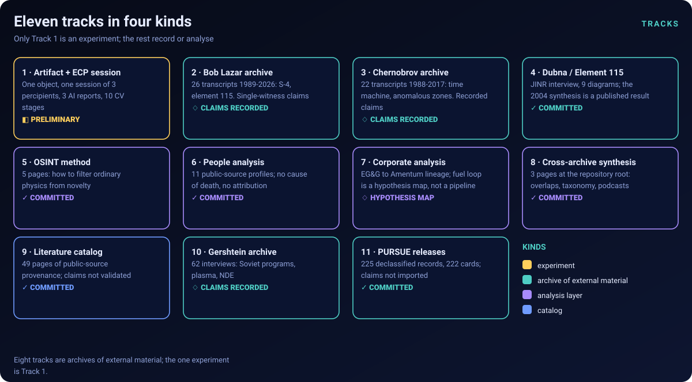
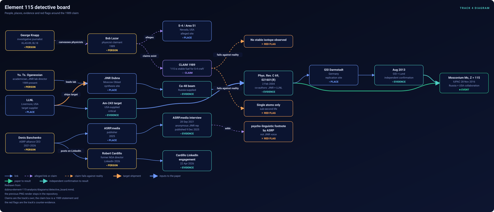
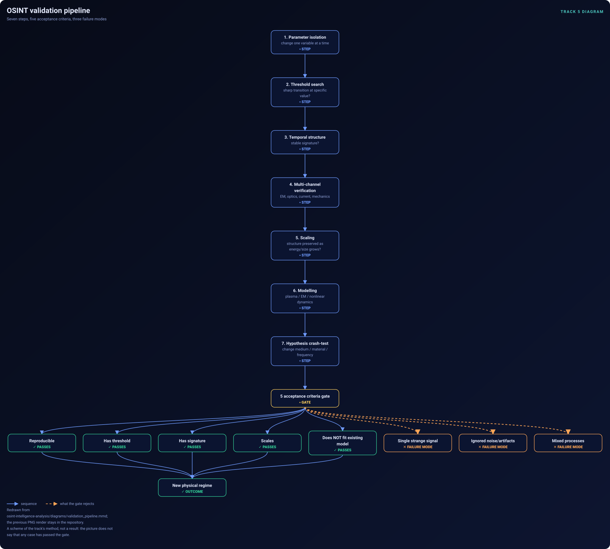
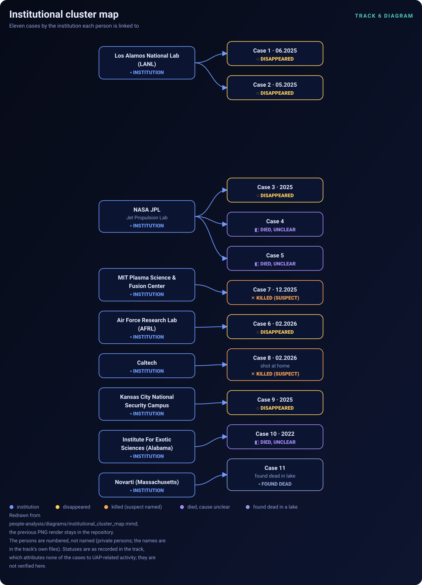
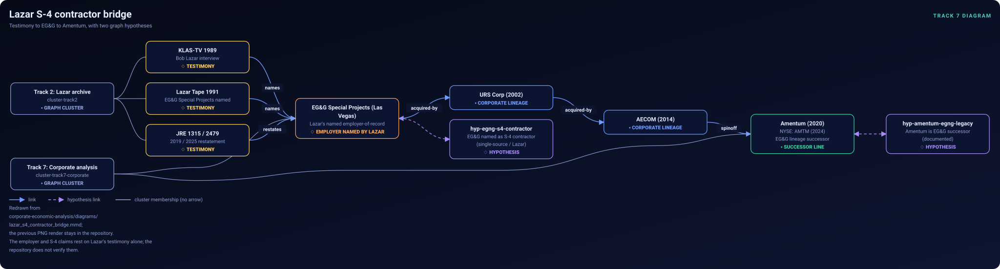
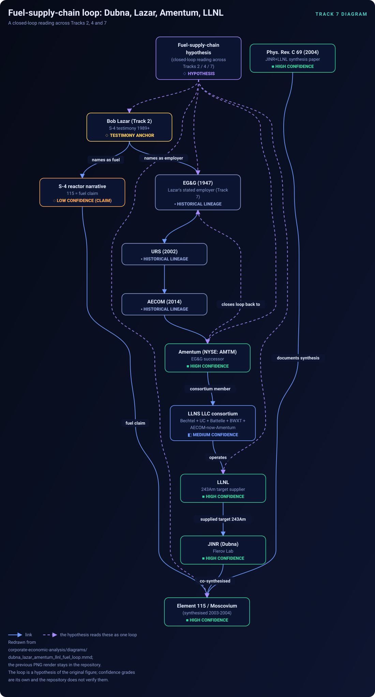
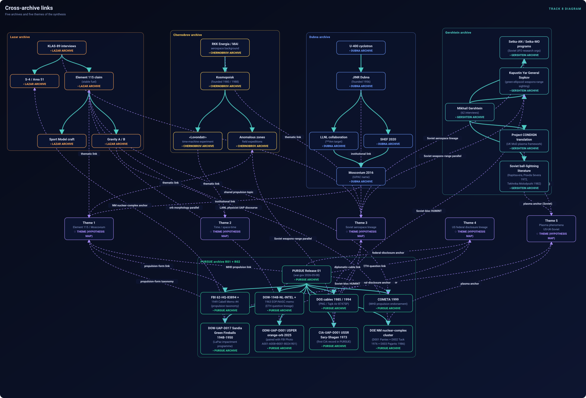
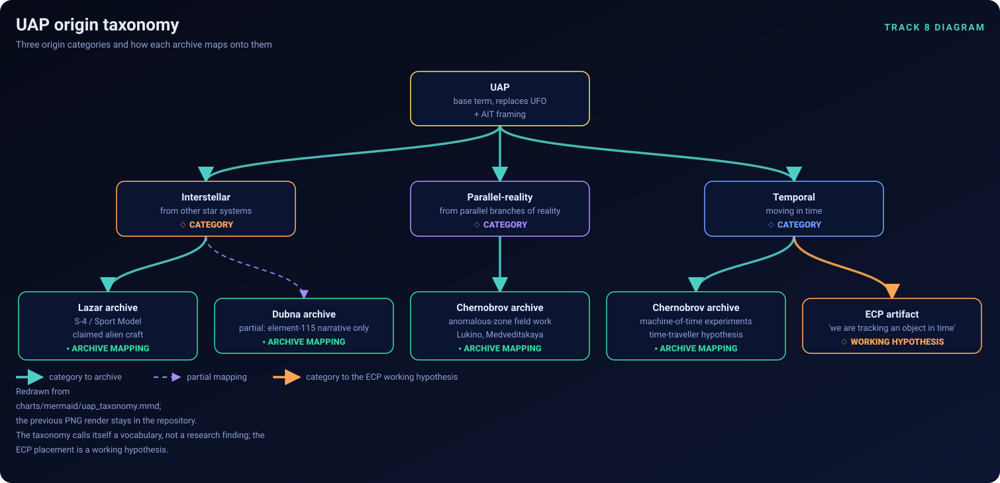

**English | [Русский](TRACKS.ru.md)**

[← UAP Reverse Engineering Study](../README.md) · [Guide index](README.md)

# Research tracks

## Eleven tracks

| Track | Subject | Status | Lead file |
|---|---|---|---|
| **1. Artifact investigation** | UAP-FRAG-001 ECP+AI multi-pipeline | Available | [Track 1](EXPERIMENT.md) |
| **2. Bob Lazar archive** | Lazar interview corpus 1989–2026 (S-4, element 115, gravity propulsion) | Available | [`bob-lazar-archive/README.md`](../bob-lazar-archive/README.md) |
| **3. Vadim Chernobrov archive** | Kosmopoisk Russian field research 1988–2017 (time-machine, anomalous zones) | Available | [`chernobrov-archive/README.md`](../chernobrov-archive/README.md) |
| **4. Dubna / Element 115** | ASRP.media JINR+LLNL interview, moscovium synthesis 2003 | Available | [`dubna-element-115-analysis/README.md`](../dubna-element-115-analysis/README.md) |
| **5. OSINT + Intelligence Analysis** | Methodology layer — signature analysis, anomaly classification, validation pipeline | Available | [`osint-intelligence-analysis/README.md`](../osint-intelligence-analysis/README.md) |
| **6. People analysis** | 11 scientist deaths/disappearances cluster (FBI 2026-04-19 announcement) | Available | [`people-analysis/README.md`](../people-analysis/README.md) |
| **7. Corporate / economic analysis** | EG&G → Amentum corporate genealogy + 4 engineering primes + 2 HSP-scanned Amentum executives + Honeywell + EG&G historical sub-units + 11-inventor patents inventory + theoretical-foundations sub-archive (Morgan / Frolov / scalar-vortex literature) | Available | [`corporate-economic-analysis/README.md`](../corporate-economic-analysis/README.md) |
| **8. Cross-archive synthesis** | Themes spanning multiple tracks | Available | [`analysis/cross-archive-synthesis.md`](../analysis/cross-archive-synthesis.md) |
| **9. UAP scientific publications corpus** | Public-source literature catalog: peer-reviewed UAP physics + social-science + government reports + observation-program technical outputs | Available | [`uap-scientific-publications/README.md`](../uap-scientific-publications/README.md) |
| **10. Gershtein archive** | Mikhail Gershtein interview corpus (~62 interviews), Soviet UAP research programs, plasma phenomena, NDE/UAP cross-references | Available | [`gershtein-archive/README.md`](../gershtein-archive/README.md) |
| **11. PURSUE Declassification** | DoW/FBI/NASA/State/**CIA/DOE/ODNI** UAP records — Release 01 (161 records, 2026-05-08) + **Release 02 (64 records, 2026-05-22)** = **225 total**: 127 PDFs + 79 mp4/aud + 14 jpg; 164 per-doc cards, 8 topical syntheses, MASTER extended (§§12–14 for R02); 0 source-code overlap between releases; new agencies **CIA / DOE / ODNI** introduced in R02 | Available | [`war-gov-pursue-archive/README.md`](../war-gov-pursue-archive/README.md) |

The tracks index above is the central navigation. Each track is independent: open the lead file to enter that track's primary material. All eleven tracks are now available, each with content in the repository; Track 1 and Track 8 live in root folders (`analysis/`, `reports/`, `experiments/`, `pipeline/`, `data/`, `charts/`), the other nine have their own folder. Only Track 1 is an experiment.

## Track 1: the artifact experiment

Multi-layered scientific study of UAP fragment **UAP-FRAG-001** through 3 analytical pipelines: AI-based visual & material analysis, archival & comparative analysis, and Extended Cognitive Perception (ECP) protocols.

Track 1 is on its own page: [Track 1: the artifact experiment](EXPERIMENT.md). It has no single lead file; its pieces are the validation report, the cross comparison, the percipient and AI reports and the two protocols.

## Archives of external material

Five tracks collect what other people said or released. They are kept as records: the repository does not validate the testimony, and the PURSUE track states that claims are not imported between archives.

### Track 2: Bob Lazar archive

Complete interview corpus of Robert Lazar's public statements on **S-4**, **Element 115**, and **gravity propulsion**, spanning **1989–2026**. The archive contains per-interview transcripts, topical analyses, a catalog organised by research period, and technical diagrams. Lazar's testimony is the most-cited modern reference for the alleged use of element 115 as a gravity-propulsion fuel and is the primary input for one of three themes in the cross-archive synthesis (Track 8).

- Unique appearances: 24
- Transcript files: 25 main + 1 external cross-reference (Russian dubs and alternate cuts: 02b, 10b, 12b, 46b)
- Period covered: 1989–2026
- Cross-references: Track 4 (Dubna / Element 115), Track 8 (cross-archive synthesis)

**Lead file:** [`bob-lazar-archive/README.md`](../bob-lazar-archive/README.md). In this study the testimony is a single-witness claim; the taxonomy page notes that no physical material is in public hands ([Evidence](EVIDENCE.md)).

### Track 3: Vadim Chernobrov archive

Research corpus of **Vadim Chernobrov** (Kosmopoisk) on **time-machine experiments**, **gravitational anomalies**, and **anomalous zones** in the territory of the former USSR, **1988–2017**. The archive includes interview transcripts, per-interview and topical analyses, a catalog by research period, and selected books. Chernobrov is the primary Russian-side input for the gravity-and-space-time and Soviet aerospace lineage themes in the cross-archive synthesis (Track 8).

- Transcripts: ~22
- Period covered: 1988–2017
- Cross-references: Track 4 (Soviet aerospace lineage), Track 8 (cross-archive synthesis)

**Lead file:** [`chernobrov-archive/README.md`](../chernobrov-archive/README.md). Figures such as the time shift of about 3 percent over 30 minutes are archive-recorded claims, not verified measurements.

### Track 4: Dubna / Element 115

ASRP.media interview with an anonymised high-ranking representative of the **Joint Institute for Nuclear Research (JINR)**, recorded **28 September 2021** and published **9 December 2025**. The track contains the raw audio transcript, verbatim EN/RU published text, a master claims table, fact-checked JINR history, the **Russia + USA equal-partner collaboration line (JINR Dubna ↔ LLNL, *Phys. Rev. C* 69, 021601(R) 2004)**, Superheavy Elements Factory (2020) data, the BN-800 / MOX analogy, the Kazakhstan-geology hypothesis framing, the Soviet-era UAP-research context (SETKA-AN / SETKA-MO), and **9 visual diagrams** (role split, detective board, synthesis flow, USA timeline, claim vs. reality, Kazakhstan hotspots, connection graph, 1989–2026 timeline, USSR aerospace map).

 Original figure: <a href="../dubna-element-115-analysis/diagrams/rendered/detective_board.png"><code>dubna-element-115-analysis/diagrams/rendered/detective_board.png</code></a>

- Diagrams: 9
- Period covered: 1965–2026 (focus on 2003 synthesis)
- Cross-references: Track 2 (Lazar element 115), Track 8 (cross-archive synthesis)

**Lead file:** [`dubna-element-115-analysis/README.md`](../dubna-element-115-analysis/README.md). The same interview is also archived inside the Lazar archive (`bob-lazar-archive/catalog/asrp_media_115_interview.md`); the two tracks do not link to each other ([Open questions](OPEN.md)). The 2004 JINR+LLNL synthesis is a published external result.

### Track 10: Gershtein archive

Interview corpus of **Mikhail Gershtein** — Russian UAP-researcher — covering Soviet UAP research programs, plasma phenomena, and cross-references between near-death experiences (NDE) and UAP encounters. The archive contains ~62 interviews with transcripts, topical analyses, and selected articles and books. It complements Track 3 (Chernobrov) on the Russian-side observational lineage and feeds into the cross-archive synthesis (Track 8) on Soviet UAP-program substrate.

- Interviews: ~62
- Cross-references: Track 3 (Chernobrov / Russian field research), Track 8 (cross-archive synthesis)

**Lead file:** [`gershtein-archive/README.md`](../gershtein-archive/README.md)

### Track 11: PURSUE Declassification

**Status: Available**

US Department of War **PURSUE Release 01** (8 May 2026, war.gov/UFO) — 161 declassified UAP records from DoW, FBI, NASA, and the Department of State, made public under the Presidential Unsealing and Reporting System for UAP Encounters. Spans 82 years (1944 foo-fighters → 2025 FBI Western US IR cluster) and includes the FBI Case 62-HQ-83894 master file (1947–1976), the September 2023 bronze-ellipsoid case (FBI ELLIPSE Sr3/4/5 + AI-composite sketch), Apollo / Skylab / Gemini transcripts and imagery (NASA-D series + VM6 active-investigation photograph), modern military mission reports (CENTCOM / INDOPACOM / AFRICOM 2013–2026 with structured-field MISREP forms), and Department-of-State diplomatic cables (1952 SECRET memo through 2004 Turkmenistan), plus the COMETA 1999 report as the only civilian / foreign source. The `war-gov-pursue-archive/` sub-archive structures the corpus into **158 per-document analytical cards**, **7 topical syntheses**, a **6362-line MASTER claims document** with EN-primary content and RU synopsis, and a **Stage-9 QA review** certifying 100 percent record coverage and clean cross-link integrity. Verdict-marker distribution across 1522 per-document claims: **74.6% CORROBORATED**, 10.6% PARTIAL, 7.1% UNRESOLVED, 4.6% REDACTED, 1.6% ANALYTICAL FLAG, 1.5% EXPLAINED. Per archive policy, **claims are not imported** between PURSUE and the sibling archives — cross-references are pointers only.

*Reading notes.* The counts above are the previous README's. Files on disk are <!--n:pursue_cards-->222<!--/n--> per-document files, <!--n:pursue_topical-->10<!--/n--> topical files and a MASTER claims file of <!--n:pursue_master_lines-->9306<!--/n--> lines, and the track's own README uses different figures again; they are not reconciled ([Open questions](OPEN.md)). The "Stage-9 QA review" is the repository's own self-assessment, not an external check.

**Lead file:** [`war-gov-pursue-archive/README.md`](../war-gov-pursue-archive/README.md)

**Cross-references:** Track 8 cross-archive synthesis Theme 4 (US federal disclosure lineage); thematic adjacency to Track 2 (Lazar element 115 / propulsion), Track 4 (Dubna / Element 115), and Track 3 (Chernobrov / Soviet aerospace lineage).

## Analysis layers

### Track 5: OSINT + Intelligence Analysis

**Status: Available**

**Methodology layer** of the hub. This track does **not** hold primary observational data — it holds the analytical lens: signal-signature analysis, anomaly classification, and the validation pipeline that separates "ordinary nonlinear physics" from "genuinely novel physical regime", and shows how that lens applies to the data-bearing tracks (Lazar, Chernobrov, Dubna / Element 115, people-analysis) and to the Track 1 ECP artifact study. Includes 4 analysis files (signature methodology, anomaly classification, validation pipeline, UAP application).

- Analysis files: 4
- Diagrams: 4 (signature classification · validation pipeline · 5 anomaly cases · methodology application across tracks)
- Coverage: applied to Tracks 1, 2, 3, 4, 6
- Source: structured working notes by Denis Banchenko, captured 2026-04-26

**Lead file:** [`osint-intelligence-analysis/README.md`](../osint-intelligence-analysis/README.md)

 Original figure: <a href="../osint-intelligence-analysis/diagrams/rendered/validation_pipeline.png"><code>osint-intelligence-analysis/diagrams/rendered/validation_pipeline.png</code></a>

Applied to the Lazar narratives, the method finds that only Element 115 passes the validation pipeline, and as standard physics: the JINR+LLNL synthesis is a published external result (`osint-intelligence-analysis/analysis/uap-application.md`).

### Track 6: People analysis

Cluster of **eleven (11) US scientists** at top national laboratories — nuclear, space, plasma, and exotic-sciences fields — who have died or disappeared since 2022, and which the **FBI under Director Kash Patel** announced on **19 April 2026** is now being investigated as a single coordinated case. The archive records the cluster, documented institutional affiliations of each person (AFRL, NASA JPL, Aerojet Rocketdyne, Kansas City National Security Campus, Los Alamos, Caltech, MIT Plasma Science and Fusion Center, Institute for Exotic Sciences, etc.), the FBI investigation scope, and Robert Cardillo's "Gabriella Rev A" analytical framework. The archive does **not** make claims about cause of death or motive — only public-source provenance.

- People profiled: 11
- Per-person files: 11
- Diagrams: 5 (institutional cluster map · timeline 2022–2026 · affiliation graph · investigation status breakdown · Cardillo Gabriella framework)
- Status breakdown: 5 disappeared · 2 killed (suspect named) · 3 died unclear · 1 found dead in lake
- FBI consolidation date: 2026-04-19 (Kash Patel on Fox News *Sunday Morning Futures* with Maria Bartiromo)
- Frameworks: FBI investigation, Cardillo "Gabriella Rev A"

**Lead file:** [`people-analysis/README.md`](../people-analysis/README.md). The per-person files are not summarised on these pages (private-person content). The FBI date comes from a single-author YouTube recap; the track's own README grades that provenance and attributes none of the cases to UAP-related activity.

 Original figure: <a href="../people-analysis/diagrams/rendered/institutional_cluster_map.png"><code>people-analysis/diagrams/rendered/institutional_cluster_map.png</code></a>

### Track 7: Corporate / economic analysis

**Status: Available**

Public-source corporate-economic analysis of the defense-prime contractor constellation behind the UAP record. Anchor thesis: **EG&G (1947) → URS (2002) → AECOM (2014) → Amentum (2020) → NYSE: AMTM (2024)** is the documented Lazar-S-4-contractor lineage, and Amentum is its present-day successor. Around it stand the four engineering primes (Lockheed Martin, Boeing, RTX, Northrop Grumman) and the services-prime ring (Amentum, Leidos, Jacobs, Parsons, BAH) operating the DoE national laboratories. v3 inventory: 8 companies (incl. Honeywell), 2 HSP-scanned Amentum executives (CEO + CTO, depersonalized) + public scanning roster of 27 entries, 7 mermaid diagrams (3 v1 + 4 v3), 6 analysis files, theoretical-foundations sub-archive (Morgan / Frolov / scalar-vortex literature).

**Lead file:** [`corporate-economic-analysis/README.md`](../corporate-economic-analysis/README.md)

 Original figure: <a href="../corporate-economic-analysis/diagrams/rendered/lazar_s4_contractor_bridge.png"><code>corporate-economic-analysis/diagrams/rendered/lazar_s4_contractor_bridge.png</code></a>

The track does not assert that any named company performed UAP reverse engineering (`corporate-economic-analysis/README.md`). Its HSP scans of public executives are described in the protocol as subjective percipient observations; they are not summarised here.

#### Fuel-supply-chain hypothesis (v4)

v4 introduces an explicit cross-archive **closed-loop reading** — Lazar (Track 2) → Element 115 fuel claim → JINR-LLNL synthesis (Track 4) → LLNL operator-consortium → Amentum (Track 7) → EG&G (Lazar's stated employer). The reading is a hypothesis-space mapping, not an institutional-pipeline claim. See [`corporate-economic-analysis/analysis/fuel-supply-chain-hypothesis.md`](../corporate-economic-analysis/analysis/fuel-supply-chain-hypothesis.md).

 Original figure: <a href="../corporate-economic-analysis/diagrams/rendered/dubna_lazar_amentum_llnl_fuel_loop.png"><code>corporate-economic-analysis/diagrams/rendered/dubna_lazar_amentum_llnl_fuel_loop.png</code></a>

### Track 8: Cross-archive synthesis

Subjects that span more than one track are kept at the **root-repository level**, not inside a specific track. This track is the meta-layer that documents the inter-track overlaps and the working classification framework.

- **[Cross-archive synthesis](../analysis/cross-archive-synthesis.md)**: documented and contested overlaps between Lazar / Chernobrov / Dubna on three themes: element 115 / Moscovium, gravity-and-space-time, and Soviet aerospace lineage. Visual: redrawn below.

 Original figure: <a href="../charts/mermaid/cross_archive_links.png"><code>charts/mermaid/cross_archive_links.png</code></a>

- **[UAP origin taxonomy](../analysis/uap-taxonomy.md)**: Denis Banchenko's 3-category origin framework (interstellar / parallel-reality / temporal) and how each archive maps onto it; the ECP artifact under study (Track 1) is tentatively placed in the temporal category as a working hypothesis. Visual: redrawn below. The taxonomy calls itself a vocabulary, not a research finding.

 Original figure: <a href="../charts/mermaid/uap_taxonomy.png"><code>charts/mermaid/uap_taxonomy.png</code></a>

- **[External podcasts and documentaries](../analysis/external-podcasts.md)**: JRE #2416 (Dan Farah, RU dub) with 7 cataloged claims; *Age of Disclosure* 2025 (deferred); 1991 Lazar Tape Russian dub (cross-link to Track 2).

## Literature catalog

### Track 9: UAP Scientific Publications Corpus

**Status: Available**

Public-source literature catalog consolidating peer-reviewed UAP physics + sensor-analysis papers, peer-reviewed social-science / history-of-ufology works, government reports (DNI/ODNI, AARO, NASA), grey literature (NIDS, AAWSAP/AATIP, SCU collected), and observation-program technical outputs (Galileo Project, Hessdalen, UAPx). v6 inventory: **~37 source-provenance entries** — 13 v4 baseline (Kean, Pasulka, Eghigian, Wendt-Duvall, NASA UAP 2023, ODNI 2021-2024, AARO public reports, Hessdalen papers, Nimitz FLIR analyses, Galileo Project papers, SCU collected papers, plus 2 cross-references back to Track 7 theoretical-foundations) + 5 v5 Banchenko Arcanum-12 cycle entries + **17 v6 HIGH-priority Perplexity-research-audit additions** (Knuth 2025 PiAS landmark, Watters/Loeb/Laukien 2023 multimodal observatories, Domine 2025 Galileo all-sky IR, Szydagis 2025 UAPx, Knuth/Powell/Reali 2019 Nimitz physics, Bruehl/Villarroel 2025 POSS-I + nuclear, Medina/Brewer/Kirkpatrick 2023 environmental, Grosvenor/Hancock/Porritt 2025 atomic-complex, Hancock 2023 SCU pattern recognition, Vallée 1998 material samples, Powell 2022 Ubatuba isotope, Powell 2019 Nimitz forensic, Lomas 2025 assessment matrix, Nolan/Vallée 2022 PiAS isotopic, Vallée/Dini/Mestchersky 2025 PiAS radiative-energy, AARO/AUI 2025 workshop, GEIPAN database) + **2 v6 adversarial-balance additions** (Condon Report 1968, USAF Blue Book Archives subsuming SIGN/GRUDGE/Twinkle predecessors). Corpus is **seed-level**, with v7+ expansion planned (eLibrary.ru / ResearchGate / Academia.edu broader pull; cross-archive integration of Track 1 isotope-pipeline and Track 7 fuel-supply-chain). Does NOT validate cataloged claims; consolidates them so the broader research can reference a stable provenance register.

**Lead file:** [`uap-scientific-publications/README.md`](../uap-scientific-publications/README.md)
