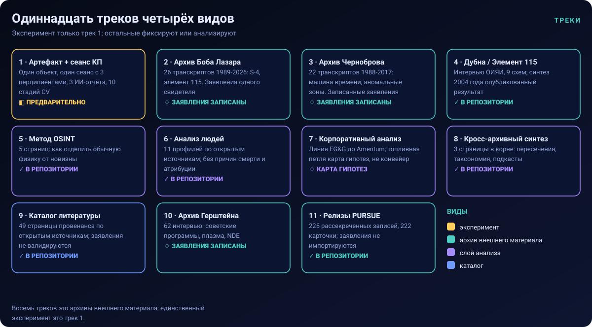

**[English](TRACKS.md) | Русский**

[← Исследование по реверс-инжинирингу НАЯ](../README.ru.md) · [Индекс руководства](README.ru.md)

# Исследовательские треки

## Одиннадцать треков

| Трек | Предмет | Статус | Главный файл |
|---|---|---|---|
| Исследование артефакта** | мульти-конвейер КП+ИИ для UAP-FRAG-001 | Доступно | [Трек 1](EXPERIMENT.ru.md) |
| Архив Боба Лазара** | Корпус интервью Лазара 1989–2026 (S-4, элемент 115, гравитационная силовая установка) | Доступно | [`bob-lazar-archive/README.md`](../bob-lazar-archive/README.md) |
| Архив Вадима Черноброва** | Космопоиск, российские полевые исследования 1988–2017 (машина времени, аномальные зоны) | Доступно | [`chernobrov-archive/README.md`](../chernobrov-archive/README.md) |
| Дубна / Элемент 115** | Интервью ASRP.media с ОИЯИ+LLNL, синтез московия 2003 | Доступно | [`dubna-element-115-analysis/README.md`](../dubna-element-115-analysis/README.md) |
| **5. OSINT и разведывательный анализ** | Методологический слой — анализ сигнатур, классификация аномалий, конвейер валидации | Доступно | [`osint-intelligence-analysis/README.md`](../osint-intelligence-analysis/README.md) |
| Анализ людей** | Кластер из 11 смертей/исчезновений учёных (объявление ФБР 19.04.2026) | Доступно | [`people-analysis/README.md`](../people-analysis/README.md) |
| Корпоративный / экономический анализ** | Корпоративная генеалогия EG&G → Amentum + 4 инженерных prime + 2 HSP-сканированных руководителя Amentum + Honeywell + исторические подразделения EG&G + инвентарь патентов 11 изобретателей + подархив теоретических основ (Morgan / Фролов / скаляр-вихрь) | Доступно | [`corporate-economic-analysis/README.md`](../corporate-economic-analysis/README.md) |
| Кросс-архивный синтез** | Темы, охватывающие несколько треков | Доступно | [`analysis/cross-archive-synthesis.md`](../analysis/cross-archive-synthesis.md) |
| Корпус научных публикаций по UAP** | Публично-источниковый каталог литературы: рецензируемая физика UAP + социальные науки + правительственные отчёты + технические выходы программ наблюдений | Доступно | [`uap-scientific-publications/README.md`](../uap-scientific-publications/README.md) |
| Архив Герштейна** | Корпус интервью Михаила Герштейна (~62 интервью), советские UAP-программы, плазменные явления, кросс-ссылки NDE/UAP | Доступно | [`gershtein-archive/README.md`](../gershtein-archive/README.md) |
| Рассекречивание PURSUE** | Записи DoW/ФБР/NASA/Госдеп/**ЦРУ/DOE/ODNI** — Релиз 01 (161 запись, 2026-05-08) + **Релиз 02 (64 записи, 2026-05-22)** = **225 всего**: 127 PDF + 79 mp4/aud + 14 jpg; 164 карточки по документам, 8 тематических синтезов, MASTER расширен (§§12–14 для R02); 0 пересечений кодов между релизами; новые ведомства **ЦРУ / DOE / ODNI** впервые в R02 | Доступно | [`war-gov-pursue-archive/README.md`](../war-gov-pursue-archive/README.md) |

Индекс треков выше — центральная навигация. Каждый трек самостоятелен — откройте главный файл, чтобы войти в первичный материал трека. Все одиннадцать треков теперь доступны, у каждого есть содержимое в репозитории; трек 1 и трек 8 лежат в корневых папках (`analysis/`, `reports/`, `experiments/`, `pipeline/`, `data/`, `charts/`), у остальных девяти своя папка. Экспериментом является только трек 1.

## Трек 1: исследование артефакта

Многослойное научное исследование фрагмента НАЯ **UAP-FRAG-001** через 3 аналитических конвейера: ИИ-анализ визуальных и материальных характеристик, архивный и сравнительный анализ, протоколы Расширенного Когнитивного Восприятия (КП).

Трек 1 вынесен на отдельную страницу: [Трек 1: исследование артефакта](EXPERIMENT.ru.md). У него нет единого главного файла; его части это отчёт валидации, сравнение ответов, отчёты перципиентов и ИИ и два протокола.

## Архивы внешнего материала

Пять треков собирают то, что говорили или опубликовали другие люди. Они хранятся как записи: репозиторий не валидирует свидетельства, а трек PURSUE прямо говорит, что заявления между архивами не импортируются.

### Трек 2: архив Боба Лазара

Полный корпус интервью Роберта Лазара по **S-4**, **Элементу 115** и **гравитационной силовой установке** за период **1989–2026**. Архив содержит транскрипты по каждому интервью, тематический анализ, каталог по периодам и технические диаграммы. Свидетельства Лазара — наиболее цитируемая современная отсылка к предполагаемому использованию элемента 115 в качестве топлива гравитационной силовой установки и являются первичным входом для одной из трёх тем кросс-архивного синтеза (Трек 8).

- Уникальных выступлений: 24
- Файлов транскриптов: 25 основных + 1 внешний (русские дубляжи и альтернативные нарезки: 02b, 10b, 12b, 46b)
- Период: 1989–2026
- Кросс-ссылки: Трек 4 (Дубна / Элемент 115), Трек 8 (кросс-архивный синтез)

**Главный файл:** [`bob-lazar-archive/README.md`](../bob-lazar-archive/README.md). В этом исследовании свидетельство остаётся заявлением одного свидетеля; страница таксономии отмечает, что физического материала в открытом доступе нет ([Доказательства](EVIDENCE.ru.md)).

### Трек 3: архив Вадима Черноброва

Исследовательский корпус **Вадима Черноброва** (Космопоиск) по **экспериментам с машиной времени**, **гравитационным аномалиям** и **аномальным зонам** на территории бывшего СССР, **1988–2017**. Архив включает транскрипты интервью, поштучный и тематический анализ, каталог по периодам и избранные книги. Чернобров — первичный российский вход для тем гравитации и пространства-времени и советской аэрокосмической линии преемственности в кросс-архивном синтезе (Трек 8).

- Транскриптов: ~22
- Период: 1988–2017
- Кросс-ссылки: Трек 4 (советская аэрокосмическая линия преемственности), Трек 8 (кросс-архивный синтез)

**Главный файл:** [`chernobrov-archive/README.md`](../chernobrov-archive/README.md). Цифры вроде сдвига времени около 3 процентов за 30 минут — записанные в архиве заявления, а не проверенные измерения.

### Трек 4: Дубна / Элемент 115

Интервью ASRP.media с неразглашённым высокопоставленным представителем **Объединённого института ядерных исследований (ОИЯИ)**, записанное **28 сентября 2021** и опубликованное **9 декабря 2025**. Трек включает сырой транскрипт аудио, дословный EN/RU опубликованный текст, мастер-таблицу утверждений, проверенную историю ОИЯИ, **связку равноправных партнёров Россия + США (ОИЯИ Дубна ↔ LLNL, *Phys. Rev. C* 69, 021601(R) 2004)**, данные Фабрики сверхтяжёлых элементов (2020), аналогию БН-800 / МОКС, гипотезную рамку геологии Казахстана, контекст советских UAP-исследований (SETKA-AN / SETKA-MO) и **9 визуальных схем** (разделение ролей, детективная доска, поток синтеза, хронология США, заявление vs. реальность, hotspots Казахстана, граф связей, хронология 1989–2026, карта аэрокосмоса СССР).

- Диаграмм: 9
- Период: 1965–2026 (фокус на синтезе 2003 года)
- Кросс-ссылки: Трек 2 (Лазар, элемент 115), Трек 8 (кросс-архивный синтез)

**Главный файл:** [`dubna-element-115-analysis/README.md`](../dubna-element-115-analysis/README.md). То же интервью заархивировано и внутри архива Лазара (`bob-lazar-archive/catalog/asrp_media_115_interview.md`); эти два трека не ссылаются друг на друга ([Открытые вопросы](OPEN.ru.md)). Синтез ОИЯИ+LLNL 2004 года — опубликованный внешний результат.

### Трек 10: архив Герштейна

Корпус интервью **Михаила Герштейна** — российского UAP-исследователя — охватывающий советские UAP-программы, плазменные явления и кросс-ссылки между околосмертным опытом (NDE) и UAP-контактами. Архив содержит ~62 интервью с транскриптами, тематический анализ, избранные статьи и книги. Он дополняет Трек 3 (Чернобров) по российской наблюдательной линии и входит в кросс-архивный синтез (Трек 8) по советской UAP-программной подложке.

- Интервью: ~62
- Кросс-ссылки: Трек 3 (Чернобров / российские полевые исследования), Трек 8 (кросс-архивный синтез)

**Главный файл:** [`gershtein-archive/README.md`](../gershtein-archive/README.md)

### Трек 11: рассекречивание PURSUE

**Статус: Доступно**

**PURSUE Релиз 01** Министерства войны США (8 мая 2026, war.gov/UFO) — 161 рассекреченная запись по НАЯ от DoW, ФБР, NASA и Госдепартамента, обнародованная в рамках программы Presidential Unsealing and Reporting System for UAP Encounters. Охватывает 82 года (foo-fighters 1944 → ИК-кластер ФБР Western US 2025) и включает мастер-файл дела ФБР 62-HQ-83894 (1947–1976), дело бронзового эллипсоида сентября 2023 (FBI ELLIPSE Sr3/4/5 + ИИ-композит-набросок), транскрипты и снимки Apollo / Skylab / Gemini (NASA-D серия + фотография активного расследования VM6), современные военные mission reports (CENTCOM / INDOPACOM / AFRICOM 2013–2026 со структурированными формами MISREP), дипломатические телеграммы Госдепа (от секретной памятки 1952 до Туркменистана 2004), плюс отчёт COMETA 1999 как единственный гражданский / иностранный источник. Подархив `war-gov-pursue-archive/` структурирует корпус в **158 аналитических карточек по документам**, **7 тематических синтезов**, **MASTER-документ заявлений на 6362 строки** с основным контентом на EN и русским синопсисом, а также **QA-обзор Этапа 9** с подтверждением 100% покрытия записей и чистой целостности перекрёстных ссылок. Распределение меток вердиктов по 1522 заявлениям per-document: **74.6% CORROBORATED**, 10.6% PARTIAL, 7.1% UNRESOLVED, 4.6% REDACTED, 1.6% ANALYTICAL FLAG, 1.5% EXPLAINED. По политике архива **заявления между PURSUE и смежными архивами не импортируются** — перекрёстные ссылки служат только указателями.

*Примечания к прочтению.* Числа выше взяты из прежнего README. Файлов на диске: <!--n:pursue_cards-->222<!--/n--> по документам, <!--n:pursue_topical-->10<!--/n--> тематических и один MASTER-файл заявлений на <!--n:pursue_master_lines-->9306<!--/n--> строки, а README самого трека снова называет другие цифры; они не согласованы ([Открытые вопросы](OPEN.ru.md)). «QA-обзор Этапа 9» — собственная оценка репозитория, а не внешняя проверка.

**Главный файл:** [`war-gov-pursue-archive/README.md`](../war-gov-pursue-archive/README.md)

**Кросс-ссылки:** Тема 4 кросс-архивного синтеза Трека 8 (линия федерального раскрытия США); тематическая смежность с Треком 2 (Лазар, элемент 115 / силовая установка), Треком 4 (Дубна / Элемент 115) и Треком 3 (Чернобров / советская аэрокосмическая линия).

## Слои анализа

### Трек 5: OSINT и разведывательный анализ

**Статус: Доступно**

**Методологический слой** хаба. Этот трек **не содержит** первичных наблюдательных данных — в нём аналитическая оптика: анализ сигнатур сигналов, классификация аномалий и конвейер валидации, отделяющий «обычную нелинейную физику» от «действительно нового физического режима»; показано, как эта оптика применяется к трекам с данными (Лазар, Чернобров, Дубна / Элемент 115, анализ людей) и к ECP-артефакту Трека 1. Включает 4 аналитических файла (методология сигнатур, классификация аномалий, конвейер валидации, применение к UAP).

- Аналитических файлов: 4
- Диаграмм: 4 (классификация сигнатур · конвейер валидации · 5 аномальных случаев · применение методологии по трекам)
- Покрытие: применяется к Трекам 1, 2, 3, 4, 6
- Источник: структурированные рабочие заметки Дениса Банченко, зафиксированы 26.04.2026

**Главный файл:** [`osint-intelligence-analysis/README.md`](../osint-intelligence-analysis/README.md)

Применённый к нарративам Лазара, метод находит, что конвейер валидации проходит только Элемент 115, и как стандартная физика: синтез ОИЯИ+LLNL — опубликованный внешний результат (`osint-intelligence-analysis/analysis/uap-application.md`).

### Трек 6: анализ людей

Кластер из **одиннадцати (11) американских учёных** из ведущих национальных лабораторий (ядерная, космическая, плазменная и «экзотическая» сферы), погибших или пропавших без вести с 2022 года, который **ФБР под руководством директора Кэша Пателя** объявило **19 апреля 2026 года** объектом единого скоординированного расследования. Архив фиксирует кластер, документированные институциональные аффилиации каждого фигуранта (AFRL, NASA JPL, Aerojet Rocketdyne, Kansas City National Security Campus, Лос-Аламос, Caltech, Центр плазмы и термоядерного синтеза MIT, Institute for Exotic Sciences и др.), периметр расследования ФБР и аналитическую рамку «Gabriella Rev A» Роберта Кардилло. Архив **не** делает утверждений о причинах смертей или мотивах — только публичные источники.

- Фигурантов: 11
- Файлов по фигурантам: 11
- Диаграмм: 5 (карта институциональных кластеров · хронология 2022–2026 · граф аффилиаций · разбивка статусов расследования · рамка Gabriella Кардилло)
- Статусы: 5 исчезли · 2 убиты (подозреваемый известен) · 3 умерли неясно · 1 найден в озере
- Дата консолидации ФБР: 2026-04-19 (Кэш Патель на Fox News *Sunday Morning Futures* с Марией Бартиромо)
- Рамки: расследование ФБР, «Gabriella Rev A» Кардилло

**Главный файл:** [`people-analysis/README.md`](../people-analysis/README.md). Файлы по отдельным людям на этих страницах не пересказываются (содержание о частных лицах). Дата ФБР взята из пересказа одного автора на YouTube; README самого трека оценивает уровень этого провенанса и не относит ни один из случаев к UAP-деятельности.

### Трек 7: корпоративный / экономический анализ

**Статус: Доступно**

Корпоративно-экономический анализ на публичных источниках созвездия prime-подрядчиков обороны за UAP-нарративом. Якорный тезис: **EG&G (1947) → URS (2002) → AECOM (2014) → Amentum (2020) → NYSE: AMTM (2024)** — задокументированная линия подрядчика Lazar-S-4, и Amentum — её современный преемник. Вокруг — четыре инженерных prime (Lockheed Martin, Boeing, RTX, Northrop Grumman) и сервисное кольцо (Amentum, Leidos, Jacobs, Parsons, BAH), оперирующее национальными лабораториями DOE. Инвентарь v3: 8 компаний (включая Honeywell), 2 HSP-сканированных руководителя Amentum (CEO + CTO, деперсонализировано) + публичный реестр сканирования из 27 записей, 7 диаграмм mermaid (3 v1 + 4 v3), 6 аналитических файлов, подархив теоретических основ (Morgan / Фролов / скаляр-вихрь).

**Главный файл:** [`corporate-economic-analysis/README.md`](../corporate-economic-analysis/README.md)

Трек не утверждает, что какая-либо названная компания занималась реверс-инжинирингом НАЯ (`corporate-economic-analysis/README.md`). HSP-сканы публичных руководителей описаны в протоколе как субъективные наблюдения перципиентов; здесь они не пересказываются.

#### Гипотеза цепочки топливоснабжения (v4)

v4 вводит явное кросс-архивное **замкнутое прочтение** — Лазар (Трек 2) → утверждение про Элемент 115 как топливо → синтез JINR-LLNL (Трек 4) → операторский консорциум LLNL → Amentum (Трек 7) → EG&G (заявленный работодатель Лазара). Прочтение — отображение пространства гипотез, а не утверждение об институциональном конвейере.

### Трек 8: кросс-архивный синтез

Темы, охватывающие более одного трека, размещены на **уровне корневого репозитория**, а не внутри конкретного трека. Этот трек — мета-слой, фиксирующий межтрековые пересечения и рабочую классификационную рамку.

- **[Кросс-архивный синтез](../analysis/cross-archive-synthesis.md)**: задокументированные и оспариваемые пересечения Лазара / Черноброва / Дубны по трём темам: элемент 115 / Московий, гравитация и пространство-время, советская аэрокосмическая линия преемственности. Схема: [`charts/mermaid/cross_archive_links.png`](../charts/mermaid/cross_archive_links.png).
- **[Таксономия происхождения UAP](../analysis/uap-taxonomy.md)**: трёхкатегорная классификация происхождения, предложенная Денисом Банченко (межзвёздные / параллельная реальность / темпоральные), и соответствие каждого архива одной или нескольким категориям; ECP-артефакт Трека 1 предварительно помещён в темпоральную категорию как рабочая гипотеза. Схема: [`charts/mermaid/uap_taxonomy.png`](../charts/mermaid/uap_taxonomy.png). Таксономия сама называет себя словарём, а не результатом исследования.
- **[Внешние подкасты и документалки](../analysis/external-podcasts.md)**: JRE #2416 (Дэн Фара, рус. дубляж) с 7 зафиксированными claim-ами; «Эпоха раскрытия» 2025 (отложено); рус. дубляж 1991 Lazar Tape (перекрёстная ссылка в Трек 2).

## Каталог литературы

### Трек 9: корпус научных публикаций по UAP

**Статус: Доступно**

Публично-источниковый каталог литературы, консолидирующий рецензируемые работы по физике UAP + сенсорному анализу, рецензируемые социально-научные / историко-ufology работы, правительственные отчёты (ODNI/DNI, AARO, NASA), «серую литературу» (NIDS, AAWSAP/AATIP, собрание SCU), технические выходы программ наблюдений (Galileo Project, Hessdalen, UAPx). Инвентарь v6: **~37 записей провенанса** — 13 из v4-базовой линии (Kean, Pasulka, Eghigian, Wendt-Duvall, NASA UAP 2023, ODNI 2021-2024, публичные отчёты AARO, работы Hessdalen, FLIR-анализы Nimitz, опорные работы Galileo Project, собрание работ SCU, плюс 2 кросс-ссылки на Track 7 theoretical-foundations) + 5 добавлений v5 цикла Банченко на Arcanum-12 + **17 HIGH-приоритетных добавлений v6 из аудита Perplexity-исследования** (веха Knuth 2025 PiAS, мультимодальные обсерватории Watters/Loeb/Laukien 2023, всенебесная ИК Galileo Domine 2025, UAPx Szydagis 2025, физика Nimitz Knuth/Powell/Reali 2019, POSS-I + ядерные Bruehl/Villarroel 2025, экологический анализ Medina/Brewer/Kirkpatrick 2023, атомный комплекс Grosvenor/Hancock/Porritt 2025, паттерны SCU Hancock 2023, материальные образцы Vallée 1998, изотопы Ubatuba Powell 2022, криминалистика Nimitz Powell 2019, матрица оценки Lomas 2025, изотопы PiAS Nolan/Vallée 2022, излучательная энергия PiAS Vallée/Dini/Mestchersky 2025, семинар AARO/AUI 2025, база GEIPAN) + **2 состязательно-балансирующих добавления v6** (Отчёт Кондона 1968, Архивы Blue Book ВВС США, включающие предшественников SIGN/GRUDGE/Twinkle). Корпус — **семенного уровня**, расширение v7+ запланировано (расширенный пулл eLibrary.ru / ResearchGate / Academia.edu; кросс-архивная интеграция конвейера изотопного анализа Трека 1 и фуэл-supply-chain Трека 7). НЕ валидирует каталогизированные утверждения; консолидирует их так, чтобы более широкое исследование могло ссылаться на стабильный регистр провенанса.

**Главный файл:** [`uap-scientific-publications/README.md`](../uap-scientific-publications/README.md)
